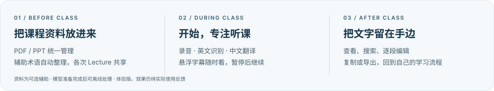

<p align="center">
  
</p>

<p align="center"><strong>录下课堂，跟上英文，把自己的学习资料留在 Mac。</strong></p>
<p align="center">macOS 原生课堂助手 · 本地识别与翻译 · 悬浮双语字幕</p>

<p align="center">
  <a href="https://github.com/lotus116/LectureFlow/releases/latest"></a>
  
  
  
</p>

<p align="center">
  <a href="https://github.com/lotus116/LectureFlow/releases/latest"><strong>下载 macOS 体验版 →</strong></a>
  &nbsp; · &nbsp; <a href="docs/USER_GUIDE.md">使用指南</a>
  &nbsp; · &nbsp; <a href="docs/RELEASE-0.6.1.md">0.6.1 更新说明</a>
  &nbsp; · &nbsp; <a href="https://github.com/lotus116/LectureFlow/issues">反馈问题</a>
</p>

<br>

<p align="center"></p>

## 一门课程，一个本地学习空间

**上课时，少一点操作。** 开始、暂停、继续、结束；按需选择录音与双语字幕、仅录音或仅字幕。悬浮窗置顶显示中文与英文，不必一直打开主窗口。

**课后，让文字方便使用。** 实时记录和课后转写放在同一页，支持搜索、逐段编辑与重新翻译。复制全文，或导出 TXT、Markdown、SRT、JSON。

**资料放一次，各次 Lecture 共享。** PDF/PPT 统一归属课程，后台整理相关拼写提示。课件明确中英对照和人工校正辅助翻译；自动生成的译名仅作建议，不强行替换原话。

## 0.6.1 · 本轮成果

本版汇总简化课程流程、原生界面整理及 **课程词表污染修复**。移除笔记与云端总结 API，聚焦录音、转写和翻译。

- 区分英文拼写证据与中文译名，拦截解释句、原文回填和冲突译名。
- 旧派生词表自动重新整理，人工修改、停用记录和历史转写保留。
- 统一实时、课后及单段重新翻译的词表筛选，避免整份词表干扰当前语句。

[完整发布说明](docs/RELEASE-0.6.1.md) · [修复细节与验证证据](docs/TERMINOLOGY_QUALITY_FIX.md)

## 开始使用

**Apple Silicon Mac · macOS 26+ · 建议至少 16 GB 内存**

1. 在 [发布页](https://github.com/lotus116/LectureFlow/releases/latest) 下载 macOS 压缩包，解压，将 **LectureFlow.app** 拖入“应用程序”。
2. 新建课程，点击 **开始新 Lecture**，或导入已有录音。
3. 按需加入课程资料。用悬浮字幕听课，结束后在转写页查看或生成课后结果。

发布包自带运行环境，无需 Python 或 Xcode。首次需联网准备约 **1.86 GB** 默认模型，支持暂停和继续；准备期间可以先管理课程或仅录音。模型准备完成后，录音、识别、翻译和资料解析可在本机离线运行。

更新前结束录制并完全退出旧版，再替换应用。安装、麦克风授权及本地签名说明见 [使用指南](docs/USER_GUIDE.md)。

<details>
<summary><strong>从源码启动最新开发版</strong></summary>

需要 Xcode 与上述系统环境：

```sh
git clone https://github.com/lotus116/LectureFlow.git
cd LectureFlow
zsh scripts/setup
zsh scripts/run
```

已有项目时，保留本地改动并同步代码后运行 `zsh scripts/run`。开发版依赖项目目录，不能单独复制给其他电脑。测试与独立打包见 [开发指南](docs/DEVELOPMENT.md)。

</details>

## 当前边界

这是阶段体验版。**准确率、翻译质量、延迟、续航及三小时连续使用评估仍暂缓，未验收通过。** 已有功能测试和少量合成术语短测不代表完整课堂效果。

离线字幕时间戳约为 30 秒处理区间；复杂课件解析和专业词译名仍可能有误。应用使用本地签名，尚未经过 Apple 公证。提交反馈时请描述操作、预期与实际结果，无需默认上传原录音、课件或含隐私的日志。

---

<p align="center">
  <a href="docs/STATUS.md">实际进度</a> &nbsp; · &nbsp;
  <a href="docs/PRODUCT_DESIGN-2026-10-31.md">产品设计</a> &nbsp; · &nbsp;
  <a href="docs/SD_TRACKING.md">需求核对</a> &nbsp; · &nbsp;
  <a href="docs/DEVELOPMENT.md">开发与构建</a>
</p>
<p align="center"><sub>琪露诺主题为非官方同人视觉，与原作及玩偶制造商无官方关联。Logo 与横幅使用 AI 辅助创作。</sub></p>
