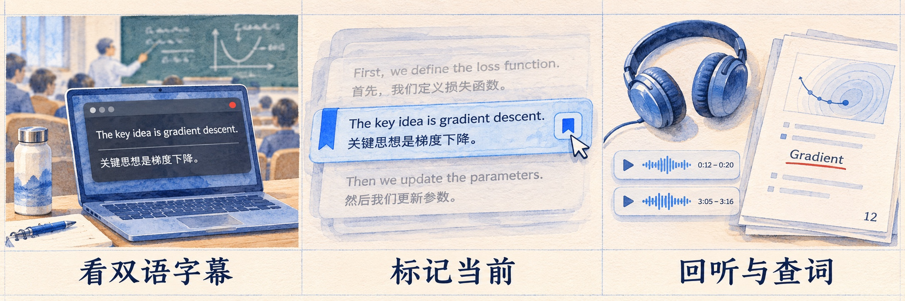
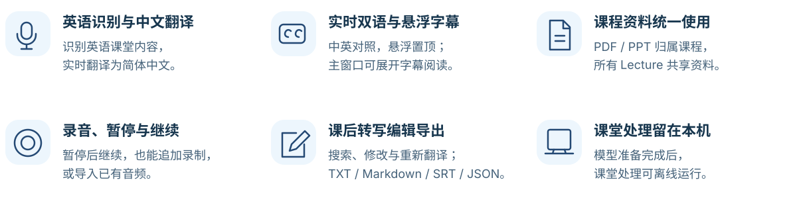
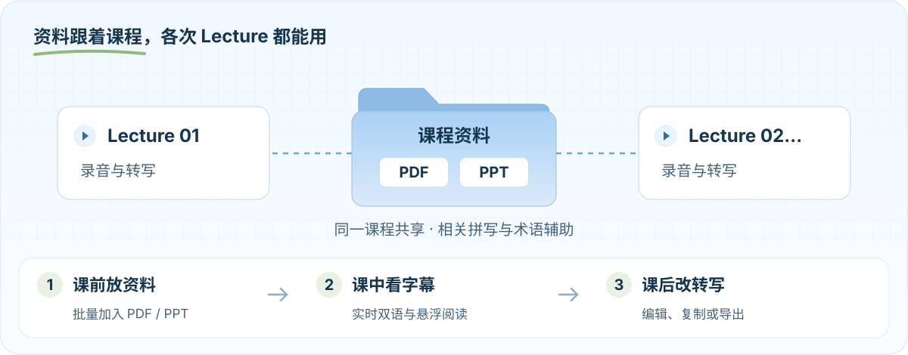

<p align="center">
  
</p>

<p align="center"><strong>为英语课堂准备的 macOS 与 Windows 本地助手</strong><br>上课看双语字幕，听不懂时留个书签，下课回到那句话听原音。录音、识别和翻译都在自己的电脑上完成。</p>

<p align="center">
  <a href="https://github.com/lotus116/LectureFlow/releases/latest"><strong>下载 LectureFlow</strong></a>
  &nbsp; · &nbsp; <a href="docs/USER_GUIDE.md"><strong>使用指南</strong></a>
  &nbsp; · &nbsp; <a href="docs/RELEASE-0.6.5.md">0.6.5 更新说明</a>
  &nbsp; · &nbsp; <a href="https://github.com/lotus116/LectureFlow/issues">反馈问题</a>
</p>

<p align="center"><sub>Apple Silicon · macOS 26+ ／ Windows 11 x64 · 安装无需 Python 或 Xcode</sub></p>

## 30 秒认识 LectureFlow

https://github.com/user-attachments/assets/bce2ea8e-fe6d-42c6-8753-bb23f85fd44c

<p align="center"><sub>BGM：休憩うさぎ（<a href="https://x.com/QK_rabbit_2/status/1968963279730233345">@QK_rabbit_2 · 原作</a>）</sub></p>

---

## 从上课到复习

<p align="center">
  
</p>

1. **开始记录。** 新建课程并开始一个 Lecture，选择录音与双语字幕、仅录音或仅字幕。课件可按需添加，也可以导入已有录音做课后转写。
2. **听到疑问就打书签。** 在主窗口或置顶浮窗看英文转写和流式中文初译。后文到来时，应用会回改前两段译文。遇到没听懂的地方，点「标记当前」就能继续听课。
3. **课后回到那句话。** 在这堂 Lecture 打开「复习标记」。保存了原音且能定位时，会从上一句开头播到当前句末尾。想整理整堂课，可以从录音生成课后转写，逐段编辑、重译或导出。

<details>
<summary>查看功能总览图</summary>



</details>

## 用课件核对拼写

**想核对一个听不清的专业词，可以从书签查课件。** 先在书签里听原音，再点有疑问的那句。可以指定本节 PPT 或 PDF，也可以选中句中连续一至四个词缩小范围。结果最多列出三页，附文件名、页码和页内原文，供你对照老师的发音与课件写法。[书签复习操作](docs/USER_GUIDE.md#用书签标记听不懂的位置)

资料按课程共享，导入一次即可供多次 Lecture 使用。上课时，应用只挑跟当前句子相关的少量术语作拼写提示。翻译可参考课件里明确的中英对照及手动校正的译名。导入资料对不同课程的实时识别准确率能有多大帮助，仍待验证。[课程资料与术语](docs/USER_GUIDE.md#课程资料与术语) · [课件对照实验](docs/research/CONTEXT_PPT_EXPLORATION.md)

<details>
<summary>查看资料如何在同一课程的 Lecture 之间共享</summary>



</details>

## 安装

| 平台 | 0.6.5 安装方式 |
|---|---|
| Apple Silicon · macOS 26+ | 解压 ZIP，将 `LectureFlow.app` 拖入“应用程序”。首次使用字幕需联网准备约 1.86 GB 默认模型。应用使用本地签名，尚待 Apple 公证。 |
| Windows 11 x64 | 将 ZIP 完整解压到新目录，运行其中的 `LectureFlow.exe`。默认识别和翻译模型随包提供。 |

更新前请结束采集，等保存完成后退出旧版。[下载两端正式版](https://github.com/lotus116/LectureFlow/releases/tag/v0.6.5) · [安装说明](docs/USER_GUIDE.md#安装)

<details>
<summary><strong>从源码启动</strong></summary>

Windows 源码构建见[开发指南](docs/DEVELOPMENT.md)。Mac 开发环境需要 Xcode。在终端运行：

```sh
git clone https://github.com/lotus116/LectureFlow.git
cd LectureFlow
zsh scripts/setup
zsh scripts/run
```

已有项目时，保留本地改动并同步代码后运行 `zsh scripts/run`。开发版依赖项目目录；构建、测试与独立打包见[开发指南](docs/DEVELOPMENT.md)。

</details>

## 体验版的当前边界

面向英语课堂，默认固定英语识别，输出简体中文。Mac 提供默认关闭的实验性口音复核。远场讲话、专业词和数值仍可能识别或翻译出错，三小时连续使用与续航仍待验证。[验证结果与适用范围](docs/STATUS.md)

实时记录支持 Markdown 和 JSON 导出。课后转写还支持 TXT 和 SRT，时间戳对应约 30 秒的处理区间。[使用指南](docs/USER_GUIDE.md)

---

<p align="center">
  <a href="docs/README.md">文档导航</a> &nbsp; · &nbsp;
  <a href="docs/STATUS.md">实际进度</a> &nbsp; · &nbsp;
  <a href="docs/PRODUCT.md">产品设计</a> &nbsp; · &nbsp;
  <a href="docs/STATUS.md#需求实现矩阵">需求核对</a> &nbsp; · &nbsp;
  <a href="docs/design/OPEN_ITEMS.md">下一步讨论</a> &nbsp; · &nbsp;
  <a href="docs/research/SPEECH_RESEARCH-2026-11-05.md">语音增强研究</a>
</p>
<p align="center"><sub>琪露诺主题为非官方同人视觉，与原作及玩偶制造商无官方关联。横幅与课堂流程插画使用 AI 辅助创作，插画中的字幕为示例。</sub></p>
