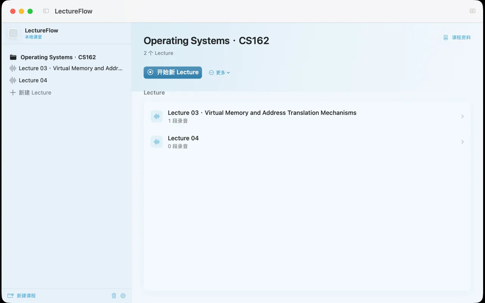
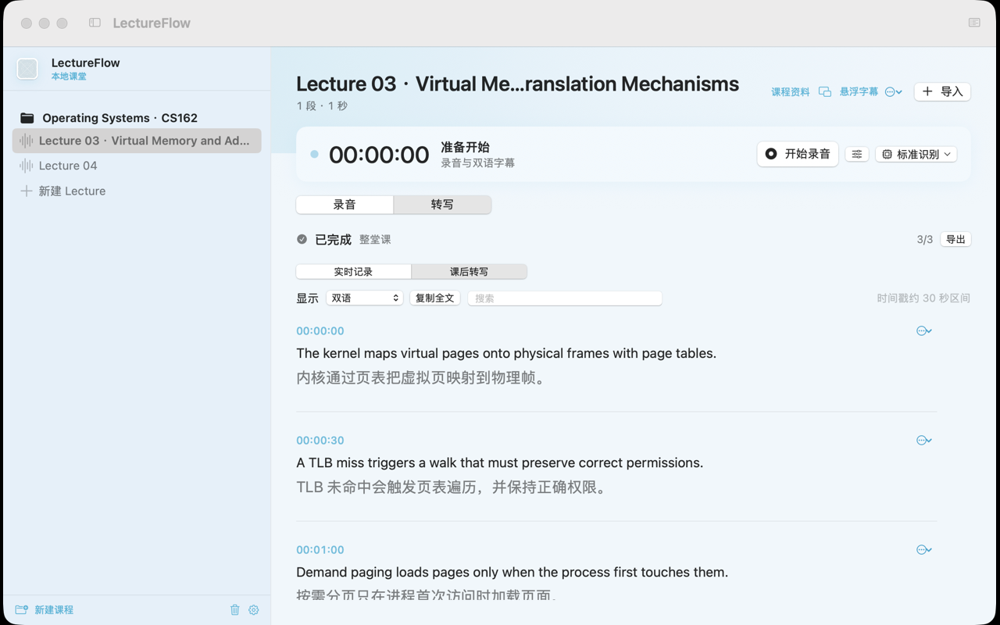

<p align="center">
  
</p>

<p align="center">
  录音 · 英文转写 · 中文翻译 · 课程资料 — 都在你的 Mac 上完成。
</p>

<p align="center">
  <a href="https://github.com/lotus116/LectureFlow/releases/latest"></a>
  
  
  
</p>

<p align="center">
  <a href="https://github.com/lotus116/LectureFlow/releases/latest"><strong>下载体验版</strong></a>
  &nbsp;·&nbsp;
  <a href="docs/USER_GUIDE.md">使用指南</a>
  &nbsp;·&nbsp;
  <a href="#从源码体验">最新源码</a>
  &nbsp;·&nbsp;
  <a href="https://github.com/lotus116/LectureFlow/issues">反馈</a>
</p>

<br>

<p align="center">
  
</p>
<p align="center">
  <sub>课程主页 · 冰蓝侧栏与安静的 Lecture 列表</sub>
</p>

<br>

<p align="center">
  
</p>
<p align="center">
  <sub>转写页 · 实时记录与课后结果独立保留，英文在上、中文在下</sub>
</p>

## 能做什么

| 上课时 | 下课后 | 课程资料 |
| :--- | :--- | :--- |
| 录音、暂停与继续；悬浮双语字幕跟上课堂。也可仅录音或仅字幕。 | 同一页查看实时记录与课后转写；搜索、复制、逐段修改与导出。 | 导入 PDF / PPT；自动整理辅助术语，课程内所有 Lecture 共享。 |

录音、识别、翻译和资料解析均在本机完成。模型就绪后，上述处理可离线运行。

## 最短上手

**Apple Silicon · macOS 26+ · 建议 ≥ 16 GB 内存**

1. 从 [发布页](https://github.com/lotus116/LectureFlow/releases/latest) 下载，将 **LectureFlow.app** 拖入「应用程序」。
2. 新建课程 → **开始新 Lecture**，或导入已有录音。
3. 按需添加课程资料；上课看悬浮字幕，课后在转写页整理文字。

发布包自带运行环境，无需自备 Python / Xcode。首次需联网准备约 **1.86 GB** 默认模型（可暂停继续）；准备期间可先管课程或仅录音。

> 公开下载与仓库源码可能不同步。当前源码为 **0.6.0** 简化版；要体验最新界面与功能，请用下方源码步骤。

## 从源码体验

需已安装 Xcode 与上述系统环境：

```sh
git clone https://github.com/lotus116/LectureFlow.git
cd LectureFlow
zsh scripts/setup
zsh scripts/run
```

已有克隆时：退出旧应用 → 同步代码 → `zsh scripts/run`。打包与测试见 [开发指南](docs/DEVELOPMENT.md)。

## 请先知道

- 识别准确率、翻译质量、实时延迟、续航与三小时连续使用：**暂缓评估，尚未验收**。
- 课后转写时间戳约为 30 秒区间，尚未逐句精确对齐。
- 图片型 / 复杂版面课件可能需 OCR 或先转 PDF；辅助术语仍可能有误。
- 应用为本地签名，未经 Apple 公证。安装与权限见 [使用指南](docs/USER_GUIDE.md)。

反馈时请说明操作、预期与实际结果；无需默认上传原录音、课件或含隐私的日志。

---

<p align="center">
  <a href="docs/STATUS.md">进度</a>
  &nbsp;·&nbsp;
  <a href="docs/PRODUCT_DESIGN-2026-10-31.md">产品设计</a>
  &nbsp;·&nbsp;
  <a href="docs/UI_REDESIGN_BRIEF.md">界面方向</a>
  &nbsp;·&nbsp;
  <a href="design-system/lectureflow/MASTER.md">视觉规范</a>
  &nbsp;·&nbsp;
  <a href="docs/DEVELOPMENT.md">开发构建</a>
</p>

<p align="center">
  <sub>琪露诺主题为非官方同人视觉，与原作及玩偶制造商无官方关联。Logo 与横幅使用 AI 辅助创作。</sub>
</p>
