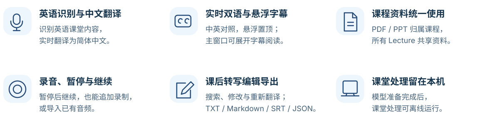
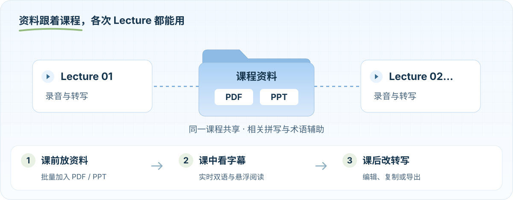

<p align="center">
  
</p>

<p align="center"><strong>为英文课堂准备的 macOS 本地助手</strong><br>录音、英译中字幕与课后转写，在自己的 Mac 上完成。</p>

<p align="center">
  <a href="https://github.com/lotus116/LectureFlow/releases/latest"><strong>下载 macOS 版 →</strong></a>
  &nbsp; · &nbsp; <a href="docs/USER_GUIDE.md"><strong>使用指南</strong></a>
  &nbsp; · &nbsp; <a href="docs/RELEASE-0.6.2.md">0.6.2 更新说明</a>
  &nbsp; · &nbsp; <a href="https://github.com/lotus116/LectureFlow/issues">反馈问题</a>
</p>

<p align="center"><sub>Apple Silicon · macOS 26+ · 建议 16 GB 内存 · 安装无需 Python 或 Xcode</sub></p>

---

<p align="center"></p>

<details>
<summary>查看完整功能说明</summary>

- **英语识别与中文翻译**：可选择录音与双语字幕、仅录音或仅字幕。
- **实时与悬浮字幕**：中英对照，悬浮窗置顶；主窗口可展开字幕阅读。
- **课程共享资料**：批量导入 PDF / PPT，所有 Lecture 共用，相关术语辅助拼写与翻译。
- **录音、暂停与继续**：暂停后继续同一段录音，结束后可追加录制，也能导入已有音频。
- **课后编辑与导出**：搜索、逐段编辑、恢复原文、重新翻译；导出 TXT、Markdown、SRT、JSON。
- **本机离线处理**：模型准备完成后，录音、识别、翻译与资料解析可离线运行。

</details>

## 一门课程，一个本地空间

<p align="center">
  
</p>

**资料放一次，各次 Lecture 共享。** 课前或课后都能新增资料；导入后自动整理相关拼写提示，辅助术语可修改、停用或补充。课件中的明确中英对照与人工校正参与翻译，自动生成的中文仅作建议。[了解课程资料与术语](docs/USER_GUIDE.md#课程资料与术语)

> [!TIP]
> **0.6.2 · 把更多空间留给字幕**<br>
> 在「转写 → 实时记录」点击「展开字幕」，收起顶部大面板，保留计时、采集控制、搜索、字号、复制与导出。点击「恢复布局」即可返回。[本版改进](docs/RELEASE-0.6.2.md)

## 三步开始上课

1. **安装并新建课程。** 从[发布页](https://github.com/lotus116/LectureFlow/releases/latest)下载 ZIP，解压，将 `LectureFlow.app` 拖入“应用程序”。
2. **开始一个 Lecture。** 点击「开始新 Lecture」或导入录音；课程资料可按需加入。上课时使用主窗口或悬浮字幕。
3. **课后留下可用的文字。** 在转写页查看实时记录，或生成课后结果，再编辑、复制或导出。

首次需联网准备约 **1.86 GB** 默认模型，支持暂停和继续；准备期间可以先管理课程或仅录音。更新前结束采集并完全退出旧版，再替换应用。

> [!NOTE]
> 当前应用使用本地签名，尚未经过 Apple 公证。如果首次打开被系统拦截，请核对下载来源，再按[安装说明](docs/USER_GUIDE.md#安装)处理。

<details>
<summary><strong>从源码启动</strong></summary>

开发环境需要 Xcode。在终端运行：

```sh
git clone https://github.com/lotus116/LectureFlow.git
cd LectureFlow
zsh scripts/setup
zsh scripts/run
```

已有项目时，保留本地改动并同步代码后运行 `zsh scripts/run`。开发版依赖项目目录；构建、测试与独立打包见[开发指南](docs/DEVELOPMENT.md)。

</details>

## 体验版的当前边界

当前流程以 **英语识别 → 简体中文翻译** 为主；多语种与语音增强仍在讨论，尚未集成。**准确率、翻译质量、延迟、续航及三小时连续使用评估仍暂缓，未验收通过。**

离线字幕时间戳约为 30 秒处理区间；复杂课件解析与专业词译名仍可能有误。已有功能测试不代表完整课堂效果。反馈时请描述操作、预期与实际结果，无需默认上传原录音、课件或含隐私的日志。

---

<p align="center">
  <a href="docs/STATUS.md">实际进度</a> &nbsp; · &nbsp;
  <a href="docs/PRODUCT_DESIGN-2026-10-31.md">产品设计</a> &nbsp; · &nbsp;
  <a href="docs/SD_TRACKING.md">需求核对</a> &nbsp; · &nbsp;
  <a href="docs/NEXT_IMPROVEMENTS.md">下一步讨论</a>
</p>
<p align="center"><sub>琪露诺主题为非官方同人视觉，与原作及玩偶制造商无官方关联。横幅使用 AI 辅助创作；流程图为功能示意，非软件截图。</sub></p>
