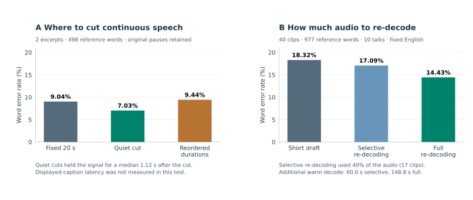
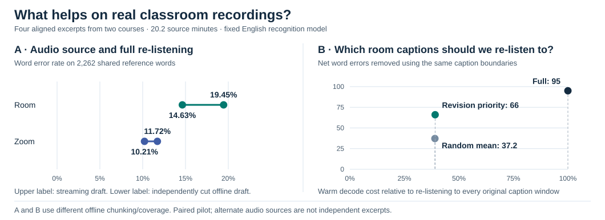
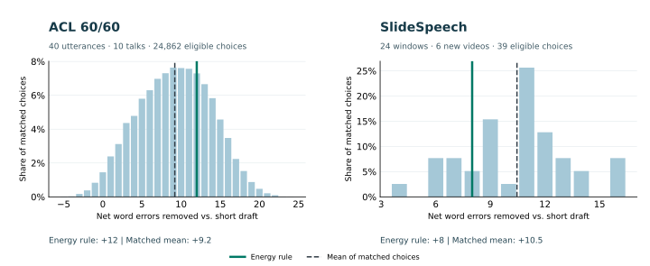

# 课堂实验决策记录 · 2026-11-25

与[统一实验证据总表](EXPERIMENT_LEDGER.md)配套。总表按实验列结论、数据与结果，本页维护跨阶段可复用的对照、复核和存档口径。

此前计划是先回答提案中的课后问题。在相同预算下，按初稿反复修改的程度选段，是否比随机选段少留错词？对同一批候选稿，还能统计节省的重听时间，以及采用候选后词错反而增加的片段数。两位组员各收一门课，同讲内普通讲解与术语密集片段各约 5 分钟。每段同时保留现场、Zoom 两份声音。实际收到 4 段内容、8 份音频、20.20 分钟独立讲话。

## 课程报告的主问题和现在能写的结果

研究对象是学生在课堂上读到的英文字幕，以及课后用于复习的转写。按[课程简报对 proposal 的记录](COURSE_EXPERIMENT_BRIEF-2026-11-21.md)，两条主线分别评价课中准确率、等待和连续性，以及课后重识别的收益、误改与计算。LectureFlow 提供能保存初稿、音频和字幕事件的实验平台。先按相同原音成对比较，再用新讲次检查观察能否迁移。不同样本、不同设备上的质量与延迟不可拼成一次端到端改进。



| 最终报告的论点 | 目前可直接写入 | 两门目标课还要给出的证据 |
|---|---|---|
| **课中：增加上下文，有哪些收益，代价在哪？** | 图 A 的两段连续演讲中，切到邻近安静处减少漏词；这种方法需在切点后再接收一段语音。已有回放记录能区分首显、末次修改、积压或中断。 | 在同一台 Mac 上以默认设置回放，保存端点原因和字幕事件；若时间轴可对齐，同时报告同一片段英语首显／稳定等待、词错、丢包与未完成段。 |
| **课后：何时值得再次听原音？** | 图 B 中，固定英语后的全量重听改善较大；在约 40% 的录音上按切点能量挑选，收益对语言设置敏感。在下文 6 个新 SlideSpeech 视频上，全量重听仍有净收益，按切点能量选段则低于等预算随机均值。另两批录音上，双模型复核均有小幅净改善，同时有明确误改案例。 | 以带时间轴的共同人工稿为参考，逐课比较原稿、全量重听、冻结选段、同预算随机；列每 10 分钟净修好词错、关键内容修好／改坏，及额外计算。 |
| **为什么有些术语仍然听错？** | 把收音差异、模型候选间的分歧、材料是否包含正确拼写分开。用可回听的专名和错误修改解释分数，另列缩写、数值或书写形式造成的得失。 | 用现场与 Zoom 的同一讲话找单侧和共有错误；只有可辨的重复错词才进入术语提示或老师适配研究。要主张适配了某位老师，须在该老师未用于选规则的另一讲做验证。 |

图 A 是两段原始连续演讲；图 B 是官方切出的 40 段短句。可在同一面板内比较条件，这两组百分数不共享测试分母。图由仓库中的两张数值表直接生成；源码随本批证据包保存。正式报告将逐项注明数据来源、开发和确认角色、真实测量与缓存回算的区别；主要结果保留能影响方法取舍的比较，余项用总账定位。

## 两门真实课堂：收音差异比离线重听增益更大（C01）



左图是 C01 自由切块全量重听；右图是 C03 只比较原字幕窗。两图不共用离线切法或覆盖量。

四组配对实际在同一台 Mac 跑完。两路音频的哈希均不同；每对三处短窗的波形峰值时间偏差小于 20 ms，支持同一讲话的近共同时间轴，不证明设备来源或任何渠道是纯净近讲音。16 个解码均完整消费音频；这里的首稿是加速流式结束时留存的英文稿，不是开口后第一条临时字幕。

| 共 2,262 个参考词 | 流式结束稿 | 全量重听 | 净少错词 |
|---|---:|---:|---:|
| 现场 | 440（19.45%） | 331（14.63%） | 109 |
| Zoom | 265（11.72%） | 231（10.21%） | 34 |

- 两门课分别单独看，方向相同；较少归一化也同向。现场改善并未抹平渠道差异：四段汇总的现场重听仍比 Zoom 原稿多 66 标准化错、34 原形错，但不是每门课、每种计分都成立：甲课保留更多原形时为 171 对 180，主要由甲课第一段带动。去掉该段，两种计分的汇总差仍分别是 +60、+49。现场原稿的 268 个替换与 72 个删除，分别高于 Zoom 的 117 和 35；但 Zoom 的插入更多（113 对 100）。不能把渠道差异一概叫作「口音」，也不能把参考稿未覆盖的额外识别一律当模型幻觉。
- 现场两段分别净少 58、8、另一个课堂的两段分别净少 20、23 错；Zoom 的四段净少 16、11、2、5 错。更短的标注片段与同一讲师聚类不支持普遍因果或统计显著主张。现场课后四段合计 63.54 秒、Zoom 为 63.76 秒，仅暖模型和切分计算约 5.2 秒/分钟，不含读取、导出、人工核对或实际产品等待。
- 参考甲两段有 12 个听不清标记，剔除文字标记而非相应音频；因此只能报同一已提供人工稿下的全片初步分数。乙两段无同类标记，仍保留同向结果（现场 230→187，Zoom 140→133，1,073 词），但不等于逐字覆盖已独立验证。总分是净变化，不能识别单次修改是否改坏事实。
- **当前取舍：**报告先把收音渠道影响和课后收益分开。保留音频并把全量重听作为可选候选，不静默覆盖原稿；不要靠调一个选择阈值包装成普遍方案。两档模型速度取舍由下文的 C02 独立实测。原始证据只留 Mac，[分段匿名数值](results/2026-11-26-classroom-paired.json)供报告复算。


## 如何让旧实验和下一轮使用同一口径

| 归属 | 必须对齐的比较 | 记录的分母与单位 |
|---|---|---|
| 提案一 · 实时分段与调度 | 同一录音、模型、解码、播放速度和翻译负载下，只改窗口或调度。同时改动者作为配置组合列出。 | 每讲独立音频分钟与参考词数。从字幕段起点到后端首个非空事件、从段末到末次变化分别计秒。首译和锁定分列。按讲列缺失、掉包及积压。 |
| 提案二 · 课后重处理与误改 | 同一原稿和候选分别应用全选、冻结选择、等预算随机。接受器另列“全部接纳候选”和“按规则接纳”，报告处理了多少、真正改了多少。 | 新配对试验用预先固定的共同时轴，按段求编辑距离再除以总参考词数，按讲报总错数、净少错数、改善／退化／持平段。历史整讲拼接评分若所用边界有别，则沿用原口径并登记。每 10 分钟净少错数用唯一可评分语音时长换算。 |
| 扩展 · 资料、文字纠错、个人适配 | 固定音频与模型比较无提示、匹配资料和错配资料。学习规则／权重时另设开发和封存讲次。发布方 ASR 文本与本项目实际推理分行。 | 实际说出术语的出现次数、命中次数、未说出提示词的新增次数、每讲人工校对分钟数。词形拆合与内容改词分别审计。 |
| 可靠性与产品回归 | 固定故障输入与新输入分别追踪，标出模型、提交、平台、回放条件。 | 任务覆盖、失败和恢复次数、首个中断时间、已保留输入范围。独立人工质量评价需要单独的参考。 |

**冻结顺序。** 输入清单 → 开发／确认角色及排除规则 → 边界、模型、阈值与预算 → 保存首遍候选及策略选段 → 读取参考评分 → 按讲报告含失败在内的全部结果。经领域复核的发布方 ASR 修订稿可能继承初稿偏差。记录参考来源、对齐过程和已知遗漏。有正式人工稿、来源未明字幕、工程回放的数据各用合适的结论。随机预算的单位和容差在看结果前固定。区间估计的重采样单位跟随独立单位（如讲师、讲次或来源视频）。已看过的确认集再用于调参时改记开发或回归。

**两路课后增益的共同分母。** 路线内保留所有本路线首稿、重听均成功的窗；若比较现场与 Zoom 哪一路更受益，只使用两路共四份输出均成功的窗，并按讲保存共同词数、两路音频秒数、四组错数。并列报告预先排除、运行失败和各自有效分母。成功但空串按漏词计；运行失败不作为空串。共同窗为零时不计算路线差。Mac 本地合成测试复现了只有 Zoom 重听失败的边界例：现场单独评价保留 9 词，跨路线比较仅保留 5 个共同词；未运行课堂模型。

**成本核算。** 每次用同一个公式列出可取得的成本分项，共有首遍 + 选择器专用预览／排序 + 入选段候选解码 + 接受核验。分别报告每种策略的课后增量和全流程合计。模型载入、暖机、音频读取、缓存重算、人工校对分别记，缺项写“未测”。同音频秒数的组可能产生不同数量的输出词和不同解码耗时，不能据此称两组实耗完全相等。对照顺序、并发负载及计时起止随运行保存。

## 如何复核和留存

| 材料层 | 每次应保留的内容 | 可执行的检查 |
|---|---|---|
| 输入和来源 | 官方论文／附件 URL、版本与取得日期，音频、参考和资料的成员名、段号、长度与 SHA-256。稀疏 ZIP 只校验实际读取的成员。取得官方完整附件后再记整包哈希。讲师和课堂输入在此前的 Mac 实验目录用随机编号关联。 | 同一成员的字节数、哈希和音频采样率应一致。两路配对的锚点和排除区要能对回同一时间轴。 |
| 方法和环境 | 固定提交或脚本哈希、依赖版本、模型权重和 tokenizer 哈希、平台线程数、窗口、提示、预算、种子与计分器版本。冻结之后修改方法时新增运行记录。 | 新成员用相同输入清单形成同一入选集。先核对样本总数、唯一语音时长、参考词数，再比指标。 |
| 原始结果 | 此前的 Mac 实验目录按“数据清单／冻结参数／逐段输出／逐段得分／汇总”存一份互相可定位的运行快照。保留原稿、候选、失败或中断状态、参考标签、计时和 SHA-256。新增分析另存。课堂音频、逐字稿、课件和讲师映射仅存此前的 Mac 实验目录。 | 逐段损益、不同归一化和是否改坏数字／术语须能回查对应输入。只有数值得分缓存时，可重建总表。重新转词、听辨或核验术语需原稿和参考。 |
| 交付 | 总表按实验登记来源、快照与本次验证级别。可共享的脚本、公开来源、匿名汇总和校验清单与私有原件分开存放。 | 第二位组员从逐段结果重建主表。核对参考词数、两稿总错数、入选段与时长、改善／退化／持平之和、耗时范围以及匹配随机样本数。每个差异留原值和原因。 |

这套规则用于解释历史缺口及登记新增运行。阶段 1–10 和实现后验证已有 E01–E13 定位。阶段 13–16 当时使用的 Mac 实验目录见[课程简报](COURSE_EXPERIMENT_BRIEF-2026-11-21.md)。在现有仓库定位不到的阶段或单项原始读数，在总表标为待查。只有取得冻结配置及逐段证据后，才能把“从报告转录”升级为“从缓存复算”或“重新运行”。

## 已有结论能支持什么

| 已有对照 | 可从已报告结果复算 | 结论的适用范围 |
|---|---|---|
| 四段录音的 20 秒、30 秒窗口 | 295→278 错，WER 9.33%→8.79%，净少 17 错 | 另一次正常语速回放中，一个样例的中文末次变化等待中位数约 31→57 秒。准确率和等待来自不同对照，无法合成为该四段的配对收益。 |
| 六位 TA，原稿／全量／选择性重听 | WER 9.24%／8.77%／8.79%，选择性相对原稿改善 0.45 个百分点，比全量高 0.02 个百分点 | 四舍五入后的点估计接近。要检验等效性，需要预定可接受的差距以及讲次或讲师层面的不确定性。 |
| 两讲 Yale，同三组 | WER 4.220%／4.083%／3.961%。选择性比全量低 0.122 个百分点。暖机课后用时 376→172 秒，少 204 秒（54.3%） | 同一结果按标准化词形比原稿少 34 错，保留原始词形仅少 5 错。54.3% 的分母仅含课后处理，未包含课堂推理、载入模型或人工校对。 |
| Yale 等时长随机选段，与较早另一轮策略 | Yale 两讲各 100 次缓存随机抽样均未追平选择性结果。较早阶段另一个策略有 57% 的随机模拟不差于它。 | 这是不同数据、不同策略的历史结果。100 次抽样描述给定缓存与预算下的分布，不代表 100 堂课或 100 次重新推理。 |
| 收紧接受规则 | 有害 19→14，有益 35→24。每少 5 次有害修改同时少 11 次有益修改，总错数 989→997。 | 明确收益与损失的频次和幅度。单看有害修改次数可能把更少动手误读为更好的判别力。 |

该段所述汇总值来自早期公开记录。11 月 25 日随后已在 Mac 上从 TA/Yale 的归档原稿、候选稿和参考重新计分，详见总账和下方统一留痕。没有重测原始耗时。原有阶段与用时定义见[课程简报](COURSE_EXPERIMENT_BRIEF-2026-11-21.md)及[早期报告底稿](COURSE_REPORT_PREPARATION-2026-11-13.md)。

## 本机可做的主线对照

使用 ACL 60/60 官方技术报告音频和领域复核参考，各讲从固定位置抽样。10 场演讲均用于 11 月早期课件研究。本轮文字试验也使用了这些讲次。此次 20 段资料提示试验与 40 段选择试验按编号互斥，与更早已解码句段的重合数仍须在此前的 Mac 实验目录核对，不能将本轮写成未见讲师或未见讲次确认。[早期样本与资料范围](CONTEXT_PPT_EXPLORATION.md)

样本取官方划好的句段，这给了理想化的外部句界。Qwen3-ASR 0.6B CPU 版和短块模拟的是有限上下文首稿。LectureFlow 的实时模型、字幕窗口、中文负载和麦克风链路需要各自验证。[数据来源及官方附件](https://aclanthology.org/2023.iwslt-1.2/)

| 冻结项 | 做法 |
|---|---|
| 音频与候选 | 884 个官方句段按 PCM 文件长度初筛，280 个落在 8–20 秒。排除本轮提示试验句段后余 272 个。每讲按 20%、40%、60%、80% 位置各取最近的一段，共 40 段。首遍无提示、分成不超过 6 秒的短块。课后对原句整段无提示再识别，保持模型与解码设置一致。 |
| 选择信息 | 在各块 75% 处识别一次预览，比较它与完成块的前缀，允许前缀长度相对于预览词数上下浮动两词。各块的最小编辑距离相加，除以预览总词数，得到该句的不稳定度。它是前缀变化的近似量，不能定位实际发音时间。选段时不读参考或课后稿。 |
| 干预与对照 | 原稿、全量重听、按不稳定度从高到低选段直接采纳课后稿，以及缓存随机选段。预算最多为全部音频的 40%。随机保留各讲相同入选段数，所选总时长与策略差不超过 0.25 秒。种子 20261125，记录 100,000 次抽样中的合格数与预算余量。可用逐段数值枚举全部满足条件的选法，对照抽样误差。补充敏感性比较在音频容差内进一步限制暖解码秒数相差不超过 5%。这是缓存估算，计算耗时只来自本机本轮。 |
| 质量与代价 | 报总参考词数、两稿词错数、逐讲及逐段改善／退化／平手、每 10 分钟净少词错。选中的音频秒数与解码耗时同时列。单列初稿、预览、整段候选耗时，并示出“线上本就有预览”和“专为选择而生成预览”两个总成本。成本来自本机运行，缓存重组的各策略总数与独立计时分开标。 |

**补充声学对照。** 一个无需生成预览的选择器只看短块切点的波形能量。取切点前后各 20 毫秒，求能量在本句全部 40 毫秒窗（步长 20 毫秒）中的百分位，对多个切点取平均。仍用 40% 音频预算、相同的并列排序及随机匹配规则。理由是高能量处硬切更可能切断发音。40 段的选择清单在首遍约 24/40 段、尚未整句解码或计分时已冻结。它是对人为短块边界的补充检验，实际产品中应另在自然连续语音与真实字幕窗上取证。复现脚本为 [boundary_energy.py](../../scripts/research/classroom_pilot/boundary_energy.py) 和 [selective_exact.py](../../scripts/research/classroom_pilot/selective_exact.py)。

比较两种信号时，各自使用匹配其讲次构成、段数和音频时长的随机分布。枚举的“追平／更好比例”只描述这些既定句段中可行选法的排序，不能解释为跨讲次显著性。与全量相比，则可直接量出省下多少重听。

### 根据运行结果作出的选择

**下一讲先检验切点能量。** 在这 408.55 秒、977 个参考词上，原稿 178 错，全量重听 142 错。切点能量选择 17 段、163.29 秒，降至 150 错，12 段改善、1 段退化。按预览不稳定度选择 16 段、157.30 秒，降至 163 错，10 段改善、4 段退化。两种策略有 7 段重合。能量法选中的各讲段数相同、总时长在容差内的选法共有 33,879 种，其中 166 种（0.49%）追平或超过它。再要求暖解码时间相差最多 5%，为 80/13,268（0.60%）。预览法对应 34/477（7.13%）及 34/410（8.29%）。若随机选法也严格遵守 40% 时长上限，能量法为 126/24,862（0.51%）。

**是否已有预览决定了计算账。** 共同的短块首稿用时 188.71 秒，另生成预览需 153.55 秒。全量候选解码用时 199.08 秒，不稳定度法和能量法入选段分别为 79.12、86.74 秒。能量法整批音频读取、哈希、能量计算及排序实测 0.33 秒。若专为选择生成预览，总计分别为全量 387.79 秒、不稳定度 421.38 秒、能量 275.78 秒。全流程数字来自暖解码计时的加总。若实时路径已经生成同一批预览，比较课后增量即可。

**语言设置和主要样例限制了外推。** 同一讲（编号以 .367 结尾）贡献了能量法 28 个净减少词错中的 15 个，不稳定度法 15 个中的 11 个。其第 156 句有 31 个参考词，短块原稿出现这 40 句所有首稿和整句稿中唯一含汉字的词元，整句重听纠正 11 个词错。事后仅重跑该句，强制英语后短块稿从 11 错降至 3 错，整句稿维持 0 错。这个病例说明自动判别语言放大了部分切窗损失。下一讲在固定英语、自然的连续输入和产品实际窗口上冻结两种选法，保留未处理原稿与独立随机对照。按高能量硬切来制造收益不符合这一验证目的。

逐段词错、所选音频和时间、全部随机选法直方图保存在证据包 `selective/results.json`、`selective/instability-exact.json` 和 `selective/boundary-energy-result.json`。预先冻结的清单是 `selective/boundary-energy-mask.json`。单句诊断保留 `selective/english-case-input.json` 中的官方成员定位和哈希、`selective/english-case.py` 及 `selective/english-case.json`。重复下载与计分见下方复现步骤。

## 术语和讲师适配的分岔

同一演讲前半段的人工修订可生成文字替换规则，在后半段与发布方 ASR 对照。10 场演讲后半段合计 7,891 个参考词。要求同一修订先出现两次时，1,080→1,035 错。排除仅拆合单词的规则后为 1,080→1,077 错，只改善 2 句。单次出现即可用的规则排除拆合词后净少 35 错，32 句改善、8 句退化。最严格规则的净收益中有 42/45 来自两种常见连写。它适合提示人工审阅，也值得作为选段信号检验。现有数据没有分离声音、话题、术语复现和书写习惯的影响。

错配讲次的文本规则提供负对照。对每个目标讲次轮流借另九讲规则，限制所用前缀句数相同。匹配句数后两种前缀仍可能包含不同词数、时长和术语。来自这组对照的平均错数不能与保留完整前半段所得的整数直接相减。下一轮若同一老师没有独立的第二讲，则优先给出渠道差异、重听预警及人工校对量，跨讲迁移留待有第二讲再检验。

## 两天内的交付与停止条件

| 到达节点 | 实际动作 | 可进入课程主表的证据 |
|---|---|---|
| 公开对照运行结束 | 冻结逐段输出及参数，从缓存重建总表。保留全部退化讲次、时间开销、抽样容差与模型规模。 | 公开技术演讲的选择性重听结果。既有演讲上探查的阈值另行命名，留给新讲次验证。 |
| 两路同段音频和校对稿到齐 | 组员用共同可听锚点对齐起止，长片在末尾复核漂移。共享同一份含时间轴的英语参考，标出重叠、静音和不可辨区域。记录每路掉音而不删掉单侧失败。 | 主表按同一参考时间轴比较两路。另一条声道能确认原话时，单侧掉音产生的空输出照计删除。确认静音处的输出照计插入。确实无法建立参考的区间单列。另报双侧清晰片段的敏感性、各路覆盖、讲次数与独立时长。 |
| 课堂初稿生成 | 两路用同一模型、同一分段、同一解码设置，明确指定英语并登记模型版本。保留每路原稿。在看参考前锁定选段分数、预算、随机和整段重听方案。在冻结的共同时间轴上重建全量、选择性、随机结果。 | 报每路每 10 分钟净少词错、修好／改坏段数、秒数与预算差。20 分钟小样只支持该录音的描述。把声音更干净的一路当参考会混入其识别误差。 |
| 实时时钟可用 | 1× 回放另存字幕事件，分开记录首次英文、首译、末次变化及待办／丢包。若能采集麦克风与屏幕的共同时钟，则另报端到端等待。 | 有时间戳的回放才产出延迟表。离线解码耗时、声道 WER 和两路音频数量均不能充当这张表的分母。 |
| 资料和第二讲到齐 | 固定模型与句界，只改变无提示／当堂 PPT／错配资料。对照词表记录说出术语的命中数、未说出的提示词引入数。对可辨且反复发错的词才计入后续适配候选。 | 封存一堂后续讲次，在已有讲次拟定规则并记录人工分钟数。单位按讲次和独立内容计算。一个老师的跨讲结果只适用于该老师。 |


## 从保存的输出复算

所有命令从本研究分支的仓库根目录运行。证据包名为 `LectureFlow_Evidence_2026-11-25.zip`。其 `manifest.json` 登记每个成员的字节数和 SHA-256；`provenance/` 保存原研究文档的固定 Git 版本、输入成员、权重与代码散列。正式数据见 [ACL 60/60 数据附件](https://aclanthology.org/2023.iwslt-1.2/)；本轮 Qwen 使用 [0.6B INT8 ONNX 固定权重](https://huggingface.co/thieunv/sherpa-onnx-qwen3-asr-0.6B-int8/tree/c12e7b0fc05e38e3949eacf3be13337c4df653b5)。包内保留本轮各方法的输出、失败与选择记录；源音频与模型按固定出处重取。

```bash
# EVIDENCE 指向解压目录；ACL_ZIP 是官方完整数据附件；QWEN 是解压后的本地模型目录。
P=scripts/research/classroom_pilot
python "$P/verify_evidence.py" "$EVIDENCE"
python "$P/memory.py" "$ACL_ZIP" > memory.json
python "$P/memory.py" "$ACL_ZIP" --segments > memory_segments.jsonl
python "$P/memory.py" "$ACL_ZIP" --prefix-budgets > prefix_budgets.json
python "$P/memory.py" "$ACL_ZIP" --donor-control > donors.json
python "$P/score.py" "$EVIDENCE/prompts/forced-english/predictions.csv" --a plain --b matching
python "$P/prompt_audit.py" "$ACL_ZIP" "$EVIDENCE/prompts/forced-english/predictions.csv"
python "$P/selective_exact.py" "$EVIDENCE/selective/results.json"
python "$EVIDENCE/selective/audit.py"
python "$P/boundary_energy.py" score "$EVIDENCE/selective/results.json" \
  "$EVIDENCE/selective/boundary-energy-mask.json"
```

重跑模型时保留一次一目录。公开音频实验使用 sherpa-onnx 2.0.3、numpy 2.5.5、soundfile 0.14.0 及包中所列权重散列。不同设备、模型转换、线程与语言设置分别记录。暖解码计时会随机器负载变化；若需精确复核本轮的成本表，使用已保存的逐调用时间。

```bash
python "$P/audio_probe.py" "$ACL_ZIP" "$QWEN" new-auto --threads 3
python "$P/audio_probe.py" "$ACL_ZIP" "$QWEN" new-english --threads 3 --language English
python "$P/selective_probe.py" "$ACL_ZIP" "$QWEN" new-selective.json --threads 2 \
  --private-traces new-traces.json
```

处理目标课堂时，评分 CSV 的必需字段为 `recording,segment,status,reference,zoom,room`。每行的 `terms` 可另列由竖线分隔的候选词，包括未说出的干扰词。在共同时间轴上准备每段的两路模型结果，再用 `python "$P/score.py" paired.csv`。确认单侧完全漏识别时保留空字符串；结果尚未运行时不给这一行计算结果。词表命中按段内出现次数封顶，缺少词级定位时只作提及计数。单次候选在正确位置修正了关键术语、数字或否定，需要附回听证据。

## 固定英语后的切点能量复核 · 2026-11-25 追加

历史逐段缓存指此前在同一台 Mac 上生成的文件。本次通过现有连接无法读取这些文件。组员预计于 11 月 26 日提供两门课的成对录音与人工稿；公开语料研究可以独立进行。本轮从总账登记的缺口中选择一个问题：锁定产品使用的英语后，切点能量能否继续帮助分配课后重听预算？所有推理在本地 CPU 上使用已下载的公开语音与权重。

**冻结与已知例外。** 复用上轮十场演讲的 40 个原始 WAV、相同的短块切法及相同的整句候选边界，逐项校验内容散列。入选的 17 段完全沿用旧的声音能量清单。固定英语，保留原模型、线程数和解码参数，重听期间没有生成选段预览。同一讲次配额、时长容差与评分代码沿用上轮。运行前已知 dev/156 的英语结果，此句作为一致性检查，并随整批重新计时。其余 39 句在此设计下产生新的固定英语输出。它们均属于上一轮已观察过的音频。

**决策标准。** 在看到本轮结果前锁定：选择性重听同时满足「相对短块初稿净少错」和「净改善超过同预算随机组合的均值」，才进入原生切点验证。两项均为优先级判断。对讲次、词错分布和人工短切点的依赖仍要复核。随机对照穷举同一批缓存中满足条件的组合，列出同分或更好的组合比例。附加比较限制音频硬预算、近似相同的暖解码用时，并分别去掉已见单句和其所在的整场演讲。

**观察与决定。** 固定英语后，全量重听净少 38 错，旧条件为 36。能量规则选中的 17 段只贡献 12 错，旧条件为 28；其余 23 段的净贡献相应从 8 变成 26。识别语种设置明显改变了哪些片段值得处理。能量规则比等预算随机平均多纠正约 2.78 个词错，但 33.45% 的匹配组合可以追平或超过它。将音频写死在 40% 预算以内也有 8,273/24,862 个组合不差于它。保留它作为低成本对照，优先检验连续讲话里能否通过改善句界直接少犯错。已知 dev/156 的固定英语短块/整句输出与旧诊断逐词一致。各组用时均取本次本机调用，选择器的 0.33 秒扫描沿用原测量值。

**迁移到课堂时怎样检验。** 现有端点策略会按停顿长短与未完句决定何时定稿，连续讲话达到时长上限也会结束字幕段。后续在未参与选规则的一讲中，用产品实际输出的边界，记录停顿触发或时长上限触发、该处能量和对应原音。先固定共同的重听窗口，再对比全量、能量选段和同预算随机。若全量重听本身有益，而能量选段在现场录音上未优于匹配随机，则降低该选段规则的优先级。若全量也无益，应先检查课后候选本身。产品端点代码见[停顿判断](../../src/lectureflow/caption_boundary.py)和[实时识别](../../src/lectureflow/live.py)。

**复算入口。** 补充证据包 `LectureFlow_Evidence_Followup_2026-11-25.zip` 与原包分开保存。它登记原包 SHA-256、冻结文件、源代码、逐次原始英文输出、参考、失败状态、耗时及按段配对的复核表。公开 JSON 仅含数字与公开语料标识。复算旧输出时复制运行目录到新位置，仅在该副本中移开原有 `results.json` 和 `references.jsonl` 供核对，再执行 `score`。从头解码可在新目录仅复制 `design.json` 与 `provenance/`，执行以下两条命令。运行环境、官方数据附件和权重版本见上一节。

```bash
python "$P/english_followup.py" decode "$ACL_ZIP" "$NEW_RUN" --model "$QWEN"
python "$P/english_followup.py" score "$ACL_ZIP" "$NEW_RUN"
```

## 连续演讲中怎样切字幕段 · 2026-11-25

**问题与取样。** 前一项实验用官方分句音频测试课后重听。本项检验另一个可以直接影响字幕质量的决定：连续讲话达到时长上限时，回到刚经过的较安静处切段，能否少认错词？在看模型输出前选定 ACL 60/60 的 dev、eval 各自第一场。从约前 10% 的句序开始，保留至少 100 秒的完整原始录音，并在首个达到时长要求的句尾结束。两段共 204.586 秒、27 个官方分句、498 个参考词，含原始句间间隙 14.797 秒。逐个分句的 PCM 在完整原音中精确定位，内部解码切点只由波形或时长决定。两位讲者在先前研究中出现过；其中两句、共 21.418 秒与上一实验重叠。参考采用主办方校后稿，句间未标字的音频保留原样，未逐字听审。

**冻结的三组。** 各组使用同一固定英语 0.6B INT8 权重、两线程、无提示，单次输出上限 256 tokens。① 每 20 秒硬切。② 同样收到 20 秒后，在第 16 至 20 秒范围每 20 毫秒寻找此前 200 毫秒能量最低的切点，切点后的音频保留到下一段。③ 在每场内部倒排②除末段外的分段长度，保留同一末段；它控制段长分布与段数，检验具体切在哪里是否重要。三组每场各切出六块，覆盖完全相同的原音。每场拼回完整识别文本后统一计算词错，避免把词移到相邻字幕误算成删除和插入。

| 原始演讲片段 | 参考词 | 固定 20 秒，词错 | 安静处回切，词错 | 同段长倒排，词错 |
|---|---:|---:|---:|---:|
| dev .268（101.779 秒） | 253 | 18 | 14 | 23 |
| eval .410（102.807 秒） | 245 | 27 | 21 | 24 |
| 合计 | 498 | 45（9.04%） | 35（7.03%） | 47（9.44%） |

**切点、代价与决定。** 安静处回切在两场分别比固定切少 4、6 错，比同段长倒排少 9、3 错，符合预先登记的方向要求。三组共用相同的官方分句时间标注，10 个内部切点中落在标注句间的数量分别是 0、4、0。这项定位只能解释一部分机制。三组暖解码组件合计依次 104.08、99.82、111.77 秒。36 个待评分块共用两个完全相同的尾块，实际调用 34 次，另有一次预热，均成功。生成三组切点用时 0.039 秒。安静处方案在所选切点后要再收到 0.26–3.94 秒音频才知道从哪里切，中位数 1.12 秒。这段算法等待和字幕首显、最终定稿的端到端延迟须分别测量。

**可回听单例。** 按两种策略句内词错差的绝对值选出 dev 第 19 句，原录音 126.385–136.232 秒。固定窗在 134.755 秒切开术语列举，输出末尾漏掉语音合成和机器翻译的部分内容。回切保住这两项，三个条件按官方稿对齐分别有 5、1、3 个局部词错。回切版本仍漏了一个填充词。这是按整段编辑距离回溯的事后定位，未作独立人工听审；原始文本、对齐结果和时间在补充包的 `independent/case.json`。

两场数字支持在课堂时长上限触发处比较一次回切。现有产品还有停顿和未完句规则；此轮没有同真实产品默认策略交手。现场与 Zoom 按默认设置先跑，保存停顿／到时触发的实际边界及字幕事件。若到时触发足够多，再在相同原音上比较回切与默认策略，连同首显和定稿的等待、词错及误改一起判断。两段公开演讲只足以决定下一步，课堂噪声、真实设备时延及两位老师的识别效果仍待测。

**复算。** 补充包的 `continuous-followup/` 保存注册方案、模型与源文件散列、每块输入帧、词稿、耗时、失败状态和独立评分。以下命令从仓库根目录运行；`SUPP` 是补充包解压目录，`R`、`NEW` 分别是新建的评分副本和空运行目录。原始完整演讲与官方分句逐一校验，两个截取 WAV、参考稿和来源索引已从官方成员重新构造并逐字节核对。[分讲次数值和散列](results/2026-11-25-continuous.json)

```bash
P=scripts/research/classroom_pilot
C="$SUPP/continuous-followup"
mkdir -p "$R" "$NEW"
cp "$C/"{boundary-plan.json,calls.jsonl,decode-metadata.json,reference.json} "$R/"
cp -R "$C/independent" "$R/"
python "$P/continuous_followup.py" score "$R"
python "$C/independent/check_results.py" "$R"
python "$C/acquisition/prepare_audio.py" "$ACL_ZIP" "$NEW"
cp "$C/weight-digests.txt" "$NEW/"
OMP_NUM_THREADS=2 OPENBLAS_NUM_THREADS=2 MKL_NUM_THREADS=2 \
  python "$P/continuous_followup.py" decode "$NEW" --model "$QWEN"
python "$P/continuous_followup.py" score "$NEW"
```

## 用另一个识别模型复核整句稿 · 2026-11-25

**问题。** 一个很小的英文识别器能否发现 Qwen 整句漏掉或听错的词，而且少改坏原稿？使用已登记的 10 场演讲、40 段原音（408.545 秒、977 个参考词），保留相同句界与相同的官方修订稿。缓存中有 Qwen 固定英语的短块稿和整句稿；本轮新增 Whisper base.en INT8 独立听原音，两线程 CPU、贪心转录、无提示。官方发布方的 ASR 稿、术语表、参考稿都没有进入融合。两个模型均在研究范围内本地运行，课堂文件继续留在授权 Mac 上。

**怎样选词。** 把整句 Qwen 的每个词、词与词之间的空位作为位置，分别对齐 Qwen 短块稿和 Whisper 整句稿。仅在后两者对同一词的替换、删除或同一空位要插入的完整词串一致时采用其改法，否则保留整句 Qwen。比较的是正规化英文词序列；标点、排版与字幕时间戳另需测量。这一实现借鉴识别结果对齐投票的思路，两个 Qwen 视图共享模型。词位规则和取样先于评分冻结。[识别结果投票的早期工作](https://www.nist.gov/publications/post-processing-system-yield-reduced-word-error-rates-recognizer-output-voting-error) · [Whisper 权重版本](https://huggingface.co/csukuangfj/sherpa-onnx-whisper-base.en/tree/59eea950fc76df2453efb57e6c0fd334548e8ffe)

**第一批，40 句。** Qwen 短块 179 错、Qwen 整句 141 错、Whisper 整句 150 错、融合 137 错（14.02%）。与整句 Qwen 相比，融合实改 13 句，8 句合计少 9 错、4 句合计多 5 错，另 1 句改了措辞但同分。10 场按净词错计为 6 场改善、3 场退化、1 场持平。如果看过人工参考、每句从两份整稿中选更准的一份，会剩 110 错；它只刻画两模型整句候选的互补空间。不能把这 110 错当作可部署分数或逐词融合的理论极限。

**内容、术语与书写。** 对照官方校后稿，融合曾把评价方法中的 *live one out* 改回 *leave one out*，也把原本正确的 *right nodes* 改成 *red nodes*。另两处的得失来自缩写与等值数值的不同写法。均可按录音号、句号和变化位置回听；这里使用发行方参考判断，未做独立人工听审。沿用每讲摘要自动选出的 4 个词，40 句里共有 27 次参考提及，Qwen 短块／整句、Whisper、融合分别命中 20／21／22／21 次。整句 Qwen 和融合都没有多计词表里的词。这个小词表衡量段内出现次数，不能代表全部专业术语。

**代价与等价跳过。** 这 408.55 秒音频上，旧 Qwen 短块与整句两组暖调用各计 177.33、148.82 秒；新 Whisper 实际暖调用 55.05 秒，逐词融合合计 0.011 秒。若 Qwen 的两份稿逐词相同，Whisper 投任何一票都不会改变融合，便可跳过该次调用。40 段中可跳 7 段（67.51 秒音频）；核验 40 个输出完全一致，按实测组件计算，Whisper 由 55.05 降至 46.14 秒。已有两份 Qwen 稿时，后者是额外暖解码成本；从头生成三份稿时，估计总组件仍需 372.30 秒，单跑 Qwen 整句为 148.82 秒。时钟来自同一研究环境的不同批次，未测 Mac 的实时字幕等待。

**同讲内的第二次检验。** 在得知主实验分数前约定，如果第一批净少错，就用另一批 20 句原样复验。取同 10 场的约 1/3、2/3 处各一句，音频哈希与 40 句完全互斥，共 141.125 秒、357 词。这些句子曾做课件提示实验，仍属于已见讲者。使用相同两线程配置重跑两个模型，20 句的无提示整句稿均与历史三线程的规范化词序列一致。下面列出全量和有机会改变整句稿的子集。

| 第二批 | 参考词 | Qwen 短块 | Qwen 整句 | Whisper 整句 | 融合 |
|---|---:|---:|---:|---:|---:|
| 全部 20 句 | 357 | 46 | 42 | 54 | 39 |
| 长于 6 秒的 11 句 | 249 | 33 | 29 | 34 | 26 |
| 其余 9 句，各只需一块 | 108 | 13 | 13 | 20 | 13 |

3 句各少 1 错，其余 17 句持平。其中一处把误写成 BERT 的西班牙语模型名称还原为参考里的 BETO；另两处分别修正动词形式与多余的词。9 个同范围短块直接复用整句输出。含两次预热共 66 次实际调用、75 次逻辑调用，全部成功。整句 Qwen 暖解码 61.24 秒，额外的短块物理解码 45.01 秒，Whisper 19.23 秒。第一批和第二批都是同一组讲者，分别报告。

**评分口径的影响。** 项目主口径会把数字拼写与缩写的差异计入词错。看到第一批存在这种例子后，追加了统一英语书写的敏感性复算，并在第二批候选打分前冻结。对参考与四份候选的既有词序列同样应用 Whisper 开源英语正规化器，第一批整句 Qwen／融合为 131／127 错（977 词），第二批为 43／41 错（360 词）。对直接从两个单模型取得的原始字符串也作独立比较，以保留小数点等线索；这一路第一批 Qwen／Whisper 为 131／121，第二批为 43／48。第一批单模型的名次随评分口径改变。正规化器由 Whisper 项目提供，其处理填充词、数值、拼写的约定与课堂可理解性仍有差别。融合输出只有词序列，未生成带标点的原始显示稿。[正规化器固定版](https://github.com/openai/whisper/blob/25639fc17ddc013d56c594bfbf7644f2185fad84/whisper/normalizers/english.py)

**课堂取舍。** 把融合保留为课后可回看的候选稿。先有现场／Zoom 基线，再在同一原音上计关键术语、数字、否定和漏句的修好与改坏。尤其检查两个辅助稿同意但仍误改的情况。若两个模型都听错同一个专名，则单列为课件词表或老师以往校对材料的候选。跨讲次的老师适配需另外留一讲验证。两批都只少了几个词错，尚不足以自动覆盖课堂原稿或宣称这一方法改善了口音识别。

**复算与留痕。** [公开配对数值](results/2026-11-25-asr-ensemble.json)关联两套冻结输入、逐句计分、坏例、归一化敏感性及计时散列。补充包 `LectureFlow_ASR_Ensemble_Evidence_2026-11-25.zip` 保存原始模型输出、各次调用结果、词位对齐、全部冻结配置、模型来源与包内校验表。从缓存复算主分数时，分别新建两个空目录，复制包中的相应输入。下列命令从仓库根目录运行，`B` 为解压目录。

```bash
P=scripts/research/classroom_pilot
mkdir -p "$R40" "$R20"
cp -R "$B/enhancement-run/provenance" "$R40/"
cp "$B/enhancement-run/"{design.json,fusion.jsonl,fusion-metadata.json} "$R40/"
cp "$B/enhancement-transfer/"{inputs.json,evaluation.csv,fusion.jsonl,fusion-metadata.json} "$R20/"
python "$P/enhancement_followup.py" score "$R40"
python "$P/enhancement_transfer.py" score "$R20"
```

两套目录的 `commands.txt` 给出实际推理参数，`enhancement-audit/` 和 `enhancement-transfer/independent/` 保存独立对齐和计分，`enhancement-diagnostic/commands.txt` 保存补充诊断的入口。

## 模型听法冲突时，材料能否帮助选词 · 2026-11-25

**为什么做。** 上轮在相同原音上观察到两个模型的读法有时互补。这里检验更窄的问题：两份整句稿对同一小段给出不同读法时，与演讲匹配的材料能否挑出正确读法？对每段都比较保留原始 Qwen、使用当场论文和轮流使用其他九篇论文；Whisper 整句作为单模型参考条件。论文近似课前能拿到的书面材料，实验所用材料没有精确到正在讲的幻灯片页。

**先冻结规则，再看新音频。** 对齐 Qwen 与 Whisper 的固定英语整句稿。只考虑两边各 1–3 个词且 Whisper 侧至少有一个含三个字母的词的连续分歧块。论文只读前八页、遇参考文献标题即止。若 Whisper 的完整候选在本篇出现至少两次、在十篇中至多三篇出现，且原 Qwen 的读法在本篇零次出现，才替换整个块。词组须在同一段落连续出现。规则只能从原音已有的两份听法中选，不得照抄材料里的第三个词。每篇材料的 PDF 和抽取物已登记出处、散列与抽取器版本。

**样本角色。** 前两轮已经看过的 40 加 20 句用于回顾，规则制定时已有 BETO 等案例的信息。另取十场各四句、合计 40 句作前瞻复核。在讲内八分之一、八分之三、八分之五、八分之七处选临近合资格句；时长限 2–20 秒，排除上述 60 句及连续演讲实验涉及的句子。新音频实际跑两模型，再冻结所有材料决策，最后才按发行方领域校后稿计分。前瞻判据同时要求词错少于 Qwen、优于九种错配材料的等权均值，而且匹配材料至少触发五个替换才有足够机会讨论效果。新旧组共享讲者和论文。

| 样本 | 参考词 | 原 Qwen 错数 | 使用匹配论文 | 使用错配论文的平均错数 | 匹配替换块数 |
|---|---:|---:|---:|---:|---:|
| 回顾，原 40 句 | 977 | 141 | 137 | 140.89 | 2 |
| 回顾，另 20 句 | 357 | 42 | 41 | 41.56 | 1 |
| **前瞻，新 40 句** | **720** | **78** | **73** | **78.00** | **4** |

**主要发现是触发太少。** 在新 40 句（300.405 秒）里，识别器共有 52 个分歧块，38 个符合长度等条件，其中 7 个 Whisper 候选在匹配材料里至少出现过一次，最后采用 4 个，分布在 3 句。5 个净少词错中，3 个来自把分开写的三个字母合成参考稿里的缩写 RGF，另 2 个来自同一句把两次 *command* 修正成 *commit*。还有一处替换后词错数持平。按事前约定的五次采纳门槛，此轮支持“书面证据偶尔可选对专名”，对稳定效果的检验机会仍不足。不能把缩写写法的三分和内容修正的两分当作五个独立知识点。

**上限和负对照。** 只用于分析：若查看参考、允许在 38 个合格分歧中逐块任选，按全句最短编辑距离可从 78 错降到 63；再要求 Whisper 的候选确实见于匹配论文，最佳为 70 错；限定使用实际采纳的四个位置，最佳为 73 错，与实际一致。按讲把十篇资料完全错配且每篇只使用一次，1,334,961 种分配在新组均为 78 错。360 个逐句错配条件里只有一个改过词，且词错数相同。这个对照反映本规则大多保持原稿，难以据此估计在陌生课程引入错误的频率。新 40 句 Qwen／Whisper 暖解码分别 128.91／39.73 秒。82 个调用含两次预热，均完成；Whisper 在 dev/10 出现了一次文本长度上限警告，该句没有触发匹配替换。

**复现。** [按句和论文的公开数值](results/2026-11-25-material-disagreements.json)与本批证据包配套。包中保留决策时的候选和逐块材料出现次数、冻结输入、参考、原始输出、耗时与所有同分及退化项。重做材料选择时用包内 `material-run/acquisition/prepare_sources.py` 按来源重取论文、重建正文，核验 `material-run/materials/provenance.json` 和冻结清单。仅复核计分则可在包解压后的新副本中操作：将三个 `inputs/<cohort>/public-results.json` 移至临时对照目录，再按 `material-run/notes.md` 的 `score` 命令复算；官方参考已缓存时不会重新取音频。上限与完整错配分布可以通过 `python material-diagnostic/diagnostics.py material-run` 复算。

## 用另一套演讲和真实幻灯片文字检验资料辅助 · 2026-11-25

**跨语料设计。** 从 [SlideSpeech 官方发布](https://www.openslr.org/144/) 的人工标注 dev、test 中各取 3 个原视频，每段视频各 3 句。先按固定散列选视频和句子，不按参考词、模型错例或 OCR 文字筛难例。保留 18/18 段，共 156.88 秒，以六个原视频作为报告单位。两模型均固定英语、同一 PCM、两线程 CPU，不给文字提示。原样本分散在不同主题，不能据此估计两门目标课的效果。两个音频档案符合发布目录 MD5。当前官方地址返回的标注／OCR 元数据归档 MD5 为 `f50ca0f851e0c73d87821a1e911a9ef2`，与目录旧值 `bfa834a7a02ba3b13e5c3f6fed82c102` 不同；已固定实际下载对象的字节数、SHA-256、ETag，独立重算 CRC64 并同源站比对。结论仅对应此版本。[逐句数值与来源](results/2026-11-25-slidespeech.json)

**识别基线和材料配对。** 18 句共 444 个参考词，整句 Qwen 51 错（11.49%），Whisper 70 错（15.77%）。换用事先固定、统一英语书写的附加口径，参考词数为 447，两者分别 40 和 51 错。36 个计分调用加各模型一次预热均成功，Qwen、Whisper 暖解码分别 70.10、24.14 秒；这批调用在 ACL 推理结束后计时。官方数据能把每句关联到带 OCR 文字区域的文件，18 句均有非空 OCR。没有可核验的幻灯片页码或帧播放时钟；“当句材料”指官方关联的文字区域。另取同视频相隔至少 30 秒且词汇明显不同的 OCR 作为错时对照，并与其他五个视频的材料逐一比较。这里无法证明错时样本一定是另一页。

**结果与决策。** 针对 OCR 稀疏的特点预先冻结另一条规则：只在 Whisper 的完整分歧词组出现在同一文字区域、而 Qwen 的对应候选缺席时采纳；课件不给模型创造新词。21 处合格分歧中，7 处至少一种读法出现在当句 OCR，2 处实际触发替换，两处都比原稿多 1 错。Qwen 原稿 51 错、当句 OCR 53、同视频错时 52、跨视频错配平均 51.2。两处分别把原稿正确的地名 *Leeds* 改为 *leads*，把正确的 *a* 改为 *the*。进一步按参考逐个试选这 21 个分歧，4 个 Whisper 读法本可单独减少词错，但这 4 个词组均未出现在对应 OCR 区域中（事后诊断）。单纯降低触发阈值也无法用该处文字证明这些改法。结果未达到预定的 5 次采纳门槛。两处误改说明材料有这个词仍可能选错，样本量无法估计该现象在所有课堂的频率。论文实验与 OCR 实验使用各自预先冻结的规则和不同样本，两者的分数不能用来排名哪种材料更好。

**报告落点。** 现阶段将资料辅助放在误差分析和扩展实验中，课件只作为回听和核对拼写的线索。后续首先完成两门课的主实验；只有出现足量可辨、反复出错的术语才启动更具体的材料干预。收到用户补入项目空间的人工稿后，先给每门课建一张固定基线表，再按原有方案比较窗口、全量重听与同预算选段。报告优先如实回答“在什么条件下有收益，在哪些句子有代价”。

**复算。** 私有补充包 `LectureFlow_Materials_and_Slides_Evidence_2026-11-25.zip` 保存冻结设计、模型和数据出处、成员散列、所有条件的逐段读数、耗时、失败／警告及脚本。对 SlideSpeech 另以每句话内一致的整数代替词面，保留整句插入、删除和替换的代价；从解压目录运行 `python material-diagnostic/slide_cache.py verify material-diagnostic/slide-word-ids.json` 可重建主口径两模型和所有材料条件的错数。重建原音／OCR／发行方参考和运行模型须重新取得相符版本的官方归档；证据包不分发原始演讲录音、幻灯片文字或论文全文。

## 等预算重听能否迁移到另一批演讲 · 2026-11-25

**问题与取样。** ACL 60/60 的固定英语实验显示整句重听有收益，但按切点能量挑选的结果，对语种设置和样本组成敏感。本轮保持模型、切块规则、预算与评分定义不变，只在另一批公开数据上作前瞻检验。排除上轮 SlideSpeech OCR 试验的六个视频，按预先固定的散列顺序从官方 dev、test 各取三个合资格视频。每个视频四段互不重叠的连续原音，限制为 12–20 秒、2–4 个相邻的标注话语，间隔须在 0–0.75 秒内。实际 24 段共 413.63 秒，每段实际均含两个标注话语，官方时间轴上二者首尾相接，共 48 个话语。计分以视频分别列示，再汇总词错与参考词数；没有把 24 段算成独立讲者。参考来自 [SlideSpeech 官方人工标注的 dev/test](https://www.openslr.org/144/)。

**比较与预算。** 所有片段均固定英语，用同一 Qwen3-ASR 0.6B INT8、两线程 CPU。首遍以时长不超过 6 秒的等长短块拼稿，候选以原段完整重听。24 段共有 57 个人工短切点；这里没有用产品在线字幕的真实切点。以每个人工切点为中心的 40 毫秒能量（前后各 20 毫秒）在本段所有 40 毫秒窗中排序，扫描步长 20 毫秒；按每段切点的平均分位排序，在总录音 40% 的硬上限内依次装入完整片段。选段仅看波形，候选和参考都不可见。冻结清单选中 9/24 段、161.92 秒（39.15%）。只将这些段的首稿替换为整段候选。随机对照保持每视频的选段个数、匹配总时长至 ±0.25 秒，同时满足硬上限。1,024 个符合视频配额的集合中有 39 个满足全部条件；以下平均值和范围覆盖全部 39 种，比例是本批可行集的描述。

| 处理条件 | 词错 / 1,212 词 | WER | 相对首稿改善 / 持平 / 退化的段数 | 首遍之外的暖计算 |
|---|---:|---:|---:|---:|
| 短块首稿 | 144 | 11.88% | — | 0 秒 |
| 能量选中的 9 段重听 | 136 | 11.22% | 6 / 17 / 1 | 83.64 秒解码 + 0.086 秒选择 |
| 全部 24 段重听 | 121 | 9.98% | 17 / 3 / 4 | 233.94 秒解码 |

**全量重听净少 23 个词错，能量选段净少 8 个。** 六个视频中，全量重听五个改善、一个退化。能量选段的净收益低于同视频配额、同音频预算组合的平均 10.46 个；39 种可行组合中，30 种比能量选择更好，2 种持平，7 种更差。事后最优组合净少 16 个，表示本批候选中确实有更好的选择。预设的筛选优势门槛（至少 20 种可行组合、优于随机均值、追平或超过者至多 5%）未通过。这一比例描述本批组合，并非对未来课堂的显著性检验。



**改变对照或计分后。** 放开各视频的配额，仍固定 9 段、总时长和硬上限，16,648 种可行选法平均净少 9.23 个词错，有 11,540 种追平或超过能量规则。采用 Whisper 英语文本规范化重算，首稿／能量／全量分别为 106／97／82 个错（1,246 个参考词）；39 种同视频配额的组合中仍有 31 种不差于能量。采用另一口径后，词数与错误数都须按该口径重新计算。词错也可能包含填充词，不能直接当成修好的知识点数。

**计算与证据。** 同一台 Linux CPU 上，载入 8.80 秒，预热 1.23 秒，共同首遍 196.11 秒。全程 1 次预热、81 次短块、24 次整窗调用均完成。选择方案的时间取实际入选调用之和再加选择开销；没有测量 Mac 课堂产品端到端延迟。首次准备因缺少父目录，在提取音频前终止。修复后两次选窗完全一致。独立实现从发行方档案重取每窗原音和参考，复核 24 个 PCM 哈希、48 个编辑距离及随机分布。仓库保留[逐窗、逐视频、分区与成本](results/2026-11-25-slidespeech-selective.json)和[主实验脚本](../../scripts/research/classroom_pilot/slidespeech_selective.py)。证据包 `LectureFlow_Selective_ReDecoding_Evidence_2026-11-25.zip` 保留冻结清单、来源及权重散列、逐次调用索引、无需模型即可复算的逐窗词 ID 和全部补充对照，入口是 `public-input/round-selective/supplement/REPLAY.md`。

**对项目的决定。** 保留全量重听作为课后质量基线，停止在已评分的公开片段上调能量阈值。下一次值得检验的是课堂实际切点是否真的截断了话音，以及哪些截断修复改变了术语、数字或否定。两课配对数据到齐后，在同一台 Mac 上用现场和 Zoom 的同一句、同一份人工稿比较首稿与整段重听，按课分别列出修好与改坏的关键内容。能量仅作冻结对照。连续窗口仍来自公开演讲，短块边界由实验构造；六个视频无法确定教师口音或教室收音的贡献。

## 两天的优先级与分工

| 时点 | 要解决的问题 | 决定后续投入的证据 |
|---|---|---|
| 11 月 25 日，公开数据 | 已完成低成本选段、连续讲话切点、跨模型与资料消歧。等待交付期间，优先解决能改变主报告取舍的问题，并准备基线图表和复现 | 保存同一原音各版本的逐段错误、切点和计算代价。即便一种规则在人工短切点表现好，也要经过连续音频才能进入课堂候选。 |
| Mac 恢复联机且配对核验通过后 | 两门课各跑现场／Zoom 默认英语基线，先查影响听懂的术语、数值、否定与漏句。推理和比对均在该 Mac 上完成 | 同一讲话配对比较，按老师分别列共有错误和单侧错误。现场错、Zoom 对的句子支持检查收音；两路都错且可听清的反复错词才支持进一步尝试课件提示或适配。老师、课程、话题同时变化，不能单独归因于口音。 |
| 初诊之后 | 从出现次数足以比较的错误中选一种干预：改切点、局部重听、两模型校对或小词表提示。留存原稿，人工核对修好与改坏的内容 | 单独报告每 10 分钟净少的错误、关键错误和新增术语、首次字幕／末次修改的等待、额外计算及人工分钟。跨讲次适配只在同一老师有另一讲封存材料时验证。 |
| 最终报告 | 先汇总有原始配对证据的正负结果；本机 TA／Yale 缓存及阶段 11–12 索引已经恢复 | 历史补查影响旧表的复现等级。公开数据和新课堂实验可各自独立出结果，无需等历史缓存。 |

## 报告复核：课后词错下降能否解释为少漏词、听准了关键内容？

本轮沿用两批固定英语的公开缓存。已有证据包包含按暖解码时间 ±5% 匹配的选段复核，因此没有继续扫描预算阈值。改变报告论点的是两个问题：词错减少落在哪类编辑，以及学生可能在意的数字和否定有没有得到保护。两项均为已见样本的事后分析，本轮新增 ASR 调用为零。课中首显、丢包和课后成本的对照已回填到[课程报告简报](COURSE_EXPERIMENT_BRIEF-2026-11-21.md)。

**词错分解。** 对每段参考和候选建立最短编辑路径，保留所有可能的替换、删除、插入计数组合。用另一种实现先最小化总距离、再分别最大化／最小化各类成本，独立核对两批共 64 段汇总值。ACL 首稿与全量重听的词错为 179→141 / 977 词，其中删除从 25–26 降至 14–15；SlideSpeech 为 144→121 / 1,212 词，删除从 49–55 变为 52–54，范围重叠。两批的替换、插入均下降。以窗口为单位，ACL 全量改善段合计少 46 错，退化段多 8 错；SlideSpeech 对应为 29 与 6。每段的净变动可能同时包含有益和有害的局部修改。[逐窗可行计数及散列](results/2026-11-25-redecode-edit-types.json) · [复算脚本](../../scripts/research/classroom_pilot/redecode_edit_types.py)

**关键内容。** 在查看本轮标记计分之前，固定英文数字、序数、否定词与缩写的词表、数值规范化及对齐规则。沿用原先 24 段、9 段的选择掩码，分别按完整窗口中的标记序列与人工参考比对。14 个参考数字标记的错误数在首稿、能量选段和全部重听三组都是 2；12 个参考否定标记的三组错误数均为 0。对原始逐段输出使用独立的标记抽取和编辑距离实现复核了三个条件的计数。两处需结合原文解释：

- 同一视频的 00042–43 段涉及文体名称。首稿写成数字 46，全量重听输出“四六”。英文标记计分少了一个插入，词面核对显示其中含有书写系统变化，尚无法据此认定重听修复了一个数量事实。
- 00094–95 段的人工稿含口语重复，数词序列为 88、8，首稿还保留一个 8，整段重听删除了这个标记。只看总 WER 或数字净变化都会忽略这次退化。

**决定。** 保留整段重听作为质量基线，能量规则仅作冻结对照。真实两课优先检查数字指向的实体、单位、否定范围、术语和整句遗漏，逐条记录原稿、候选、人工听辨及不确定项。若某类首稿错误为零，报告可修复机会为零。本次公开缓存不包含两门目标课。此前该轮公开缓存工作无法读取 Mac；随后在 Mac 上通过了合成配对检查，仍未运行现场／Zoom 配对基线，课堂原音、资料和逐字稿均未读取。

数字与否定复现入口：[冻结规则与原件散列](results/2026-11-25-slidespeech-marker-design.json)、[逐窗标记与成对事件](results/2026-11-25-slidespeech-markers.json)、[抽取和计分脚本](../../scripts/research/classroom_pilot/slidespeech_marker_audit.py)。逐窗标记以局部编号保留相等关系，便于重算；重新判断上下文须查看原始文本。


## 统一留痕与报告验收

**入口只有两份。** [实验总账](EXPERIMENT_LEDGER.md)是对照、指标与证据目录；本页只放影响报告或产品选择的理由、有效边界和复现口径。既有各阶段报告、CSV/JSON、证据包保留，不作为新的维护入口，也不改旧结果。每次新增或复算先登记稳定 ID，写清与此前实验共用哪些材料；后验分析不可重标为独立确认。

| 何时 | 冻结或记录 | 验收条件 |
|---|---|---|
| 解码前 | 问题、假设/门槛、数据许可与用途、独立单位和段边界、输入及参考 SHA-256、开发/确认身份、对照与随机预算、固定环境和配置 | 每个条件共用该比较应固定的因素；预先说明排除、失败和停止条件，口径修改保留旧版本 |
| 运行中 | 代码提交或脚本散列、模型与词表指纹、参数和种子、设备与依赖、命令、逐项原始输出、硬件负载与计时起止、失败与恢复 | 每个预期项有成功或失败记录；缓存耗时与独立端到端实测分别标记；重跑另建目录 |
| 评分与报告 | 参考版本、分母及原始计数、每讲或片段效应、误改案例、归一化敏感性、报告可支持和不可支持的措辞 | 从原件抽查/复算出主表；列真正的失败与缺失，不用不同样本、硬件、计时起点拼出一条收益曲线 |
| 封存 | 公共和保密证据分离，保留相对路径、字节数及 SHA-256 | 私有录音、课件、人工稿、推理原文及可逆身份映射只留授权 Mac。仓库只收已审查的公开或匿名聚合证据 |

**本次归档核对。** Mac 本地 114 个核心协议、完成清单、分数或验证记录被登记路径、字节数和 SHA-256，并二次逐件核对。它是核心证据索引，不是全量音频备份。阶段 12 另核对旧完成清单的 11 个散列；阶段 11 无模型成绩。TA 与 Yale 对照还保留在 `audit-20261125` 的独立文字计分脚本及本地结果里；[共享汇总](results/2026-11-25-mac-archive-rescore.json)只含匿名总数。不把复算称为新识别，也不重写参考。Yale 按少归一化口径，全量重听从 590 增至 614 错。这一反例、选择性只从 590 降至 585 错，以及阶段 16 的负结果，正文不得只选其中好看的百分比。

**本机课堂入口。** Mac `paired-classroom-20261125` 冻结两路窗口、散列、参考、排除理由，阻止错绑声道、漏结果、重复和损坏。合成检查 6/6。这是入包前的分窗流程；C01 的整片对照与 C02 的实际字幕事件已在下方记录，逐词共享时间标注仍未完成。任何一路无法判断语义时先记不确定；实际录到了、共同参考可信的句子不能因声道较差而排除。若某些课后运行失败，明确失败数，并用两稿都完成的共同窗分母，不把失败当静音。


## 课中计时与共同评分窗

用 Mac 已保存的两次公开课堂 1× 回放核对（A03）。音频均完整消费、无丢包；按包到达时钟复算，英语首次非空后台发布相对段起点的 p95 为 2.04／2.15 秒；英语最后一次可见文字变化相对段末的 p95 为 0.51／0.41 秒，而状态锁定相对段末为 60.46／59.25 秒。同样的 93／64 条字幕分母，三种事件不能互换。不是新模型运行，不是从麦克风到屏幕的延迟，也未评估英文正确率。

二十分钟公开片段的 3 个五分钟边界及十五分钟片段的 2 个边界全部切进已有字幕。起点归窗改为中点归窗，每次会挪动 2 条完整字幕。60 秒边界作敏感性检查，分别有 17/19 与 13/14 处跨字幕。跨边界字幕的总词数不等于边界错词，没有逐词时标时不按时长切文字，不将跨界词误记为删/插。先用完整已对齐录音作同一参考的质量比较；确需分窗定位时，选两路同一句的可听边界，跨界无法裁清的单独标不确定。用头尾锚估两路时钟，留一个清楚的中间锚检查残差；遇暂停或切段先分段对齐再纳入。保留实际失败标志，不以空文本代替。

[匿名汇总](results/2026-11-25-replay-projection.json) · [复算脚本](../../scripts/research/classroom_pilot/replay_projection.py)。原始缓存中的输出文本不上传；可共享的汇总分开保存。

**锁定是修订状态，不是字幕等待时长（A03 补查）。** [实现](../../src/lectureflow/live.py)在每个非空话语结束时先发布 `stable`，后两段可用于修订中文；第三个后续非空段完成时会将旧段移出修订窗口，翻译未完成则不发 `locked`。停止回放也可清空窗口。两条原始事件缓存的有效分段上限均为 20 秒；93/93、64/64 个英文段均有锁定事件。按事件顺序，两条回放分别有 90、61 条在第三个后续 `stable` 出现后锁定（其中各有 1 条在音频已全部到达后）；各余 3 条在末尾仅有 2／1／0 个后续段时锁定。这与修订窗口和末尾清空一致；缓存没有逐条记录锁定原因，不能把约 60 秒的 p95 写成定时器或首显延迟。目标课堂按路保存有效英文段、已锁定、未锁定和翻译未完成数量；仅在日志能辨认退出路径时分报常规退出和末尾清空。

**英文字幕稳定性（A04）。** A03 的“曾变化”包括纯追加。沿用原事件，按字幕 ID 比较相邻输出，分别计纯追加、覆盖已发布前缀及非空变空。参考 [Arivazhagan 等人 §3.3](https://aclanthology.org/2020.iwslt-1.27.pdf) 的前缀回退定义，用旧词元数减共同前缀长度，累计后除以最终词元数；这是把翻译指标用于后台英文识别，非屏幕或阅读实验。空格口径为 0.402／0.262；忽略大小写和多数标点后为 0.114／0.035，显示词面口径明显影响估计。词汇口径更适合初查识别文字改写，两种均留存。分开报告首发、文字末变和锁定，不能跨起点直接相减两个 p95。两条回放不视为两个独立课堂；正式现场／Zoom 结果另记。 [匿名数值](results/2026-11-25-replay-stability.json)

## 两份候选稿的校对上限（A05）

**方法选择。** 课后已有原稿／候选并排审阅原型。若只让用户在两稿已有文字之间选择，把操作从整段细化到每个分歧，最多能多纠正多少？本次复用固定英语的 ACL 与 SlideSpeech 缓存，两批均来自公开演讲。评分前[冻结比较](results/2026-11-25-two-choice-review-design.json)，包括取样、首稿与整段稿、词元、最长公共子序列的并列处理和反向对齐复核。资料、其他模型和付费 API 均未参与。此前 P12 评估两种 ASR 的短词组与材料，本次比较同一 ASR 的两种音频窗口及整句可达的最小词错。

对齐只读取两份候选稿。保留按原顺序匹配的相同词，把相邻相同词之间不一致的内容作为一个分歧，每处分歧均可保留首稿或整段稿的一侧。用参考稿对拼出的整句求最小编辑距离。全段采用首稿或整段稿始终是可行选项；评分时用了答案，结果表示这套操作能达到的上限。

| 观察 | ACL（40 段） | SlideSpeech（24 段） |
|---|---:|---:|
| 首稿／全量重听的词错 | 179／141 | 144／121 |
| 整段选较好一稿／逐处选最佳组合的最低词错 | 133／125 | 115／107 |
| 逐处分选比整段二选一再减少词错的段数 | 8 | 6 |
| 整段二选一／逐处分选能完全复现参考的段数 | 10／12 | 3／3 |
| 正向对齐需呈现的分歧块数／涉及窗口数 | 68／33 | 47／22 |
| 对应窗口的两稿中均无该词形的参考词出现数 | 91（27 段） | 73（21 段） |

反向对齐得到 70 和 47 处分歧；两种对齐所得的最低词错在每个窗口均相同。缓存留有输入和输出哈希。另从两份原证据包提取输入，以独立实现穷举每个窗口的全部组合，逐一对照动态规划的最低值。窗口内词形缺席按参考词出现次数计，可能包括书写变体；不能把它直接当成漏听的知识点。没有新解码或失败窗口，已有整段候选的生成成本仍应计入系统预算，人工审阅时间待测。

**报告取舍。** 分歧提示作为审阅入口，保留原音回听和手工改写。目标课按人工参考另列关键错项的候选覆盖，再决定逐词组选择是否值得交互成本；这里的上限不足以声称人工审阅能达到相同成绩。[报告表](COURSE_EXPERIMENT_BRIEF-2026-11-21.md) · [逐窗结果](results/2026-11-25-two-choice-review.json) · [复算脚本](../../scripts/research/classroom_pilot/two_choice_review.py)

**复现。** 在仓库根目录运行 `python scripts/research/classroom_pilot/two_choice_review.py --output /tmp/two-choice-review.json`，用 `cmp /tmp/two-choice-review.json docs/research/results/2026-11-25-two-choice-review.json` 比较完整结果。本次独立穷举从 ACL 原始 CSV 和 SlideSpeech 逐窗词元缓存出发，逐窗核对了整段最优值、正反向分块最优值、两种分块数及缺词计数，64/64 项窗口一致。原运行生成整段重听候选额外用时分别为 148.82 秒（ACL）和 233.94 秒（SlideSpeech），均为已记录的暖解码耗时。本次从缓存生成整份评分约 0.2 秒。

## 首稿低词密度：保留对照，不替换选段规则（A06）

首稿词数少可能是漏识别，也可能是慢语速、停顿或原本话少。两批公开 TA 音频共 95 片段、6 位讲者；固定沿用 R20 原稿、Qenergy 候选及旧保护规则。按同讲者词数/秒相对排名从低到高选，每批至多重听一半音频。先冻结选段，再读缓存计分。1,000 次／批随机抽样匹配每位讲者片段数，音频秒数距新规则不超过全批时长的 1%，同时遵守硬上限。两批新规则分别选 26、21 段，净少 20、18 错（随机均值 11.81、17.43；240、500 次追平或超过），首稿改写信号净少 32、28，全部重听净少 27、36。未统一词形净少 16、18。原始音频、解码成本并非各规则完全相等；数值表的候选耗时来自历史累加，不是独立端到端计时。另从原稿、候选和参考复核全部 95 片段，逐一核对 2,000 次抽样预算。新规则略过预设随机均值及原始词形门槛，但不足以替换改写信号。若需继续，冻结有声时长归一化，在未用于选规则的连续录音上验证，并区分漏词和新插入。两批已评分录音不能当作新确认集。

## 实时语音窗口：20 秒与 26 秒 1× 回放（A07）

取两批已有公开 TA 音频中各一条 55–80 秒的连续片段，按预定 ID 规则选，不读参考或得分。使用同一 Mac、同一 MLX 英文模型和代码，禁用翻译及其他增强，同时把话语端点上限与流式 ASR 窗从 20 调到 26 秒。按 20→26、26→20 交叉运行，250 ms 一包按 1× 投递。四跑都消费完整音频、无丢包。全段标准化错误为 8→8（149 词）和 22→22（151 词），保留原始词形为 16→15（147 词）、31→31（155 词），短样本未发现可重复的纠错收益。英文草稿仍约 1.2 秒首次出现（按各自字幕起点的段内中位数）。受上限影响的首个稳定事件，第一段在同一话语起点从回放第 30.11 秒变到第 36.11 秒；第二段从第 20.35 秒变到第 26.30 秒。事件对应不同覆盖长度，不是同一个词的延迟。按两组相同的每 5 秒观测点看，已稳定文字落后输入的最大距离约 20→25 秒，包含安静区、不代表屏幕阅读延迟。保持默认 20 秒。接下来比固定拉长窗口更值得检验的是：接近上限时是否只在切点仍有连续语音的情况下短暂延后，并限制额外等待。先用公开连续录音验证，真人课堂仅作独立检验，不需等待。 [数值与原始散列](results/2026-11-25-context-replay.json)


## 夜间实测：速度、选段和误改（C02–C04）

**C02｜更小的模型没有带来值得交换的速度。** 用两门课的第一段现场音，各 300 秒以上，以真实 1×、250 ms 包，交叉顺序重放两种 8-bit 模型；只度量英文后端。1.7B 的首显段内中位数分别是 1.17／1.14 秒，0.6B 两段均约 1.08 秒；稳定事件从各段结束算，中位数约 0.25–0.26／0.14–0.15 秒。四跑均零丢包，取包后剩余队列均为零；1.7B 的两稿与 C01 加速首稿同计数（113、116 错），换成 0.6B 后各为 129、134 错。先保留 1.7B。延迟是模型所在后端回调，不是每词、UI 或中文延迟；10.11 分钟是两段独立音频，四跑不是四段，也不是整堂课压力测试。

**C03｜字幕回撤提示适合拿来挑现场优先重听段。** 在不看人工稿或候选的情况下，按每秒被后续版本撤回的英文词数排序，最多重听 40% 的字幕窗秒数。对照在每轨随机打乱相同的候选窗，按同预算装入，每轨 300 组，并让实际音频秒数与选段接近（误差不超过 1 秒或 2% 中较大者）。所有策略共用独立重解码的 158 个原字幕窗，0 空稿／截断；窗外保留原样，不使用参考分句作边界。随机是缓存回算，不是 2,400 次新解码，也不是 2,400 个独立样本。C11 另从严格同样音频帧数的合规子集均匀抽样，排除随机贪心枚举顺序的解释，结论见下。

| 输入（每路 2,262 个参考词） | 原稿 | 同时长随机均值 | 按回撤选段 | 同窗全量 | 自由切块全量（C01） |
|---|---:|---:|---:|---:|---:|
| 现场 | 440 | 402.81 | 374 | 345 | 331 |
| Zoom | 265 | 261.58 | 257 | 257 | 231 |

现场选段实际 467.06 秒，比随机均值 466.02 秒，多约 1.04 秒（四片合计）；候选暖解码成本 22.58 秒，同窗全量 57.73 秒。现场四片各胜随机均值，少归一化仍同向（397 对 426.94）。Zoom 两片没胜标准化随机均值，少归一化汇总几乎无差（323 对 323.14）；与原稿相比，Zoom 四片的词错变化为 −13／+8／+1／0。自由切块不仅重听了不同覆盖量，也换了边界，不能把它与选段的差归为单一机制。保留自由切块全量作为离线质量基线，优先给现场来源显示低成本重听候选；不默认对 Zoom 启用，也不推广到未知课堂。

**C04｜旧保护规则减少一部分误改，但也挡住了更多纠正。** 在 C03 的同一批解码上后验复用以前冻结的长删规则 G0 及加数字／否定／长替换规则 G3（此前未达到开发门槛），两条规则不是在这批课堂挑出来的。现场选段的标准词错无规则／G0／G3 为 374／379／416。若把一个参考词「对／错」只定在所有最少编辑路径都一致时，G3 将选中现场的确定回归从 12 降到 7，同时把确定修好从 61 降到 25。Zoom 为 257／257／258，确定回归由 5 降到 1，修好由 10 降到 6。C01 的自由切块重听，现场至少修好 135 个对应参考词、改坏 44 个，Zoom 为 31／10；该统计不包括输出独有的插入，也不说明事实是否改变。两路首稿还有 127 个参考词位置都确定错误；先定位少数可回听、可核实的意思损失，再考虑课件术语干预。不能拿这 127 个自动当术语错。现场选段中，G3 的长替换／旧长删除／数字／否定触发标签分别是 18／6／3／2，可能重叠。结果只适用于合并规则，没有隔离数字或否定单独效果。当前设计保留原稿、并排展示候选，数字、否定或大段变化只提示复核，不自动覆盖或拒绝。[匿名逐段结果与计时](results/2026-11-26-classroom-followup.json)


### C05｜双语开启后，英文略晚，中文初稿与定稿相距较远

两门课各用此前未做 1× 的第二个现场片段（300.50、305.06 秒），保持英语识别模型、边界和音频完全一致，开启或关闭本机中文翻译。新跑四臂，换序以降低先后影响；第一个课堂的两臂先完成，第二个课堂中断无成绩，随后核验原冻结配置并补跑两个缺失条件。译模型在各臂前均已加载预热，不做内存容量或冷启动差的主张。

| 后端事件（各片中位数，秒） | 甲课：仅英语 → 英中 | 乙课：仅英语 → 英中 |
|---|---:|---:|
| 英文首显：自本段开始 | 1.17 → 1.58 | 1.17 → 1.54 |
| 英文稳定：自本段结束 | 0.27 → 0.29 | 0.27 → 0.28 |
| 含汉字译稿首显：自本段开始 | — → 2.06 | — → 2.01 |
| 中文末次变化：自本段结束 | — → 23.73 | — → 21.58 |
| 最后音频到达至后台结束 | 0.26 → 1.35 | 0.27 → 1.58 |

两课全部英文终稿和边界逐段一致，分别 97/549 和 114/556 错。四跑零丢包；双语处理后音频暂存队列最多 4 包，终态无待处理或失败翻译；最终 37/37 个英文段有含汉字译稿。中文首稿不等于定稿，不能把 2 秒说成最终译文已可复习，也不能把 22–24 秒讲成首次出现等待。没有人审中文版，不就翻译正确率下结论。此次 10.09 分钟独立真实课堂录音，不是整堂课或屏幕测量。展示时应明确标出“初译会继续修订”，生产版本未改。[匿名逐段结果](results/2026-11-26-classroom-bilingual.json)


### C06–C07｜术语提示更容易让模型说出术语，但并不让字幕更可靠

用同一 1.7B、固定英语和 C01 的所有 133 个离线原窗。两门课各从团队提供的术语表按原表顺序取前 12 个英文术语，只用名称，不用次数或参考句；匹配和错配都新解码，两臂次序交错。无提示来自 C01，逐轨重跑首块核对文本完全一致。两份材料可能为校对稿复盘后整理，故这是“手上已有相关词表”时的实验，不是课前独立抽取、不能包装成盲测或实际实时收益。

| 输入（每路 2,262 个参考词；64 次参考术语出现） | 无提示词错／覆盖 | 匹配整表 | 错配整表 | 只对拼写近似提示 |
|---|---:|---:|---:|---:|
| 现场 | 331／43 | 357／52 | 361／42 | 333／47 |
| Zoom | 231／43 | 274／49 | 275／44 | 234／43 |

覆盖是连续标准化词串的整片出现次数，按参考同词条次数封顶；词条可能重叠，不要求具体位置对应，也不能替代人工听辨。匹配全表使观察到的超额同课程术语次数从每路 1 次变成 16／15 次；错配表使两路各出现 12 次参考未列的另一门课词条，主要集中在同一片段。不把未充分覆盖的人工稿当作幻觉判定器。匹配全表对第二门课的现场两片改善 9 和 5 错，第一门课却分别多 22 和 18 错；不宣称每个片段都变差。保留更多原形的统计也未给出全表获益。

再试更克制的方案：只在无提示稿已有相近拼写、却没有完整匹配时提出最多两个词；不给其它片段任何提示。该方法冻结后才解码，不以参考选段，但同一试验数据已经看过 C06。只调用 33/133 块（现场 14、Zoom 19，全部完成），把整体退化从 +26/+43 缩到 +2/+3，仍不优于无提示。现场只救回 4 次词条覆盖，Zoom 没有净收益。结论是**不改默认，不把术语提示包装成准确率增强**。若继续研究，只值得在独立、事先提供的新课件上测试“字幕旁给出局部替代拼写”，不把有提示的整窗全文覆盖到原稿。[匿名计分](results/2026-11-26-classroom-glossary.json)

**报告的误改案例怎么选。** C01 全量重听的 220 个明确纠正／回归位置中，用团队词条标记对应参考词位置，现场术语位置修好 13、改坏 4，Zoom 修好 7、改坏 1；另现场有 1 处明确否定词位置修好。这是对齐证据，不是 20 个完整术语或 20 次语义修复。已在 Mac 留 4 个代表性私有示例（纠正／改坏各两条），3 个有可追溯的参考句时间。下一步若用于报告应先回听确认，不引用老师逐字材料，只描述“术语纠正”和“术语改坏”的机制。


### C08｜半自动提高音量或降噪，未稳定救回收音差距

取四段现场录音，以 C01 的同一切点、同一 1.7B 和固定英语重新解码。音量臂按 250 ms 窗上四分位 RMS 对齐到 −24 dBFS，增减不超过 6 dB 且避免削波；组合臂再做 85 Hz 高通加 6 dB 轻量降噪（噪声底参数 −50 dB，固定选项），核验输出帧数不变。无提示，未看新臂得分选参数。两臂各 67 窗，无截断，Zoom 仅用 C01 读数参考，不参与这次滤波。

现场初始离线、音量调整、加高通/降噪分别 331／334／332 错（2,262 标准化参考词）；少归一化为 361／363／357（2,249 词）。组合臂按四片变化为 +5、−5、−10、+11 错，改善和退化相抵，且两份计分方向不一致。不能用前两例宣称降噪有效，也不能宣称所有降噪无效；高通和降噪未分开。产品不普遍开启这些参数，报告保留为对收音差距的受控负结果。[逐片读数](results/2026-11-26-classroom-signal.json)


### C09｜55 分钟持续回放没有漏包，但中文初稿、定稿的差在长课上更明显

用另一个归档完整课堂（本机已有音频，按 50–60 分钟区间筛唯一候选）测当前双语后端，真实 1×、每包 250 ms，模型组合与 C05 相同。不是两门短课堂的新增标签，也没有为该次回放重新对照识别正确率。55.17 分钟共 52,960,125 帧悉数消费，13,241 包无丢失。194 段英文都有最终含汉字译稿并锁定，0 未完成、0 翻译失败；终段清空 1.16 秒。处理完每包后输入队列 p95 为 4 包、最大 7，待译 p95 1、最大 3。每分钟 RSS 峰值约 1,449 MiB，MLX 进程分配峰值约 3,650 MiB，两者定义不同，不能相加。

| 后端字幕事件 | 中位数 | p95 |
|---|---:|---:|
| 英文第一次输出，自段开始 | 1.85 s | 2.37 s |
| 英文稳定，自段结束 | 0.32 s | 0.71 s |
| 首次含汉字译稿，自段开始 | 2.63 s | 3.66 s |
| 中文最后一次文字变化，自段结束 | 31.47 s | 42.49 s |

本次最迟中文变化 93.67 秒；该条初译在段开始后 2.53 秒已到达，最后变化在第二条后续英文段稳定后 0.53 秒出现。第二晚变化 79.58 秒也在第二条后续英文段稳定后 0.56 秒出现。两个事件与程序接收新后文后回改的机制一致，不像全程一直在等待首次翻译；普通排队计时不能解释整段 90 秒。前/中/后三分之一英文首显中位数 1.27／1.87／2.03 秒；语音内容也在变，不能据此宣称内存泄漏或性能随运行时间下降。报告要展示的是连续处理以及「先看得到、稍后还会改」，不把汉字覆盖写成语义正确率。[完整匿名统计](results/2026-11-26-continuous-bilingual.json)


### C10｜少等后文能更快结束回改，但也会改变最后看到的翻译

从 C09 取包含两个异常慢变化的前 8.5 分钟，特意观察它们能否复现。原版仍用之后两段英文来回改；实验限制后文结束的音频位置在当前段结束后 20 秒内，同时跳过英文和后文均一致的重复请求。两组音频、模型、分段与 1× 投递相同。没有修改 App，也不把 20 秒误当成后台必须在 20 秒完成的时钟上限。

| 后端，24 段 | 默认后两段 | 20 音频秒限制 |
|---|---:|---:|
| 中文首稿，自段开始，中位 | 1.80 s | 1.81 s |
| 中文最后变动，自段结束，中位 | 8.22 s | 2.47 s |
| 中文最后变动，自段结束，p95 / 最大 | 79.60 / 93.67 s | 21.84 / 21.89 s |
| 完成的排队翻译（其中带后文） | 69（45） | 43（19） |

工作计数排除临时翻译，并非耗时、质量或用户看到的变更次数。C09 的 579 个完成工作中有 385 个带后文；分解与 194 个首轮、193 个第一个后文、192 个第二个后文机会相符，C05 的两段也与该分解一致。即使极慢事件不多，后文回改本身是常规负载。

两次英文边界和文本逐段相同，零丢包，24 段都有终态中文，无失败。原版两条最迟变化在限时组分别为 7.48 秒、在原段结束前 7.24 秒（表示随后没有再改变，非负处理延迟）。10 段的两版终态译文去除标点、空格及符号后仍有文字差异，包括最慢两段。本机已留待回听对照，不假定加长后文一定正确，也不假定早收敛一定更准。用这个配对写「后文量—定稿时间」取舍，有人工双语核验前不改默认。本段选自刚见过极值的课，p95 只有 24 条，非跨课程泛化。[匿名读数](results/2026-11-26-classroom-late-context.json)

## 报告主线建议（11 月 26 日）

1. **课中：先拿到可读初稿，再量化何时不再变。** 用 C02 说明默认 1.7B 的取舍，C05 与 C09 说明双语的实时性与连续性，C10 解释长尾回改及速度—上下文取舍。计时只到后端；归档长课不混进两门真实配对课的准确率。
2. **课后：把有限算力用于最可能改好的现场片段。** 用 C01 对齐两种收音的同一句、C03 比较同一预算下的选段与随机（附图）。报告 C04 一部分正确词也会被改坏，以及保护规则拒绝更多正确修改，故只给候选、不自动覆盖。不能把 Zoom 相对于现场的优势写成讲师口音或模型改进。
3. **不扩大战线。** C06–C08 作为负结果与机制验证：更多提示词命中未带来更准的整体字幕，固定增益/降噪也未补上收音差距。最值得的新证据是独立课堂上的选段复现，以及小规模人工回听核对后文究竟改善还是损害译文。当前样本仅两门真课四片，部分参考有不可辨标记，不能承诺跨讲者、整课词错率或译文正确率。


### C11｜把随机对照的音频预算匹配到一帧，现场结论仍成立

保持 C03 所有候选音频和文本不变，只重新抽随机参考集。每轨把窗口拆成两半枚举帧长组合，在不超过原 40% 上限的约束下，从同总帧数的所有合法子集均匀抽最多 1,000 个互异子集；更小的集合全数复算。第二种取样允许原 ±max(1 秒, 2%) 容差，不使用贪心选择顺序。现场四片标准词错都比等帧随机均值低，合计 374 对 397.89；有原容差时 374 对 404.12，原贪心随机均值 402.81。少归一化的精确预算为 397 对 421.92，总体同向；但其中一片 111 对 110.93，实质持平而按数值略差。Zoom 少归一化在精确预算下为 323 对 322.16，不支持稳定选段优势。不同随机子集不是独立语料，也不产生跨课堂显著性结果。原图 B 保持 C03 原贪心基线，在正文以 C11 做敏感性验证，不悄悄换数字。[匿名读数](results/2026-11-26-classroom-budget-sensitivity.json)
