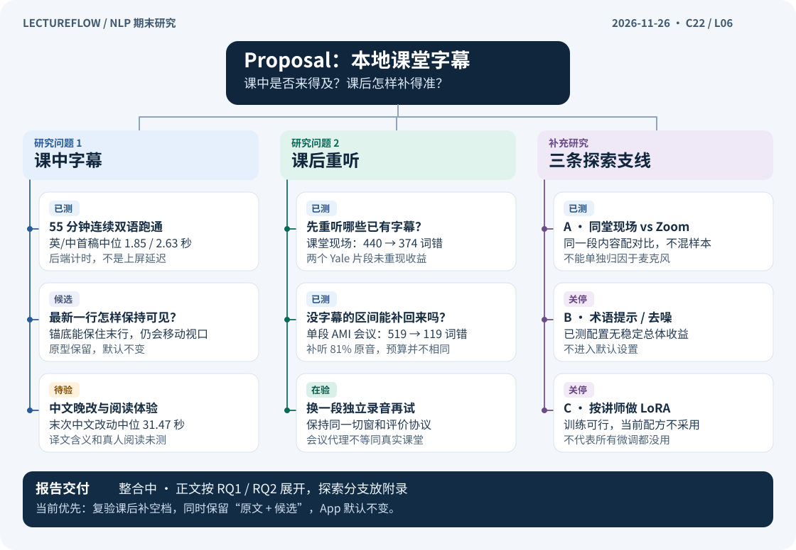

# LectureFlow｜NLP 期末研究进度图

九个方向已按课程范围收口，进入报告准备。更新至 **2026-11-27，C40 / L07**。[实验总账](EXPERIMENT_LEDGER.md)保存所有数字、对照和复算入口。

- **主线 1｜课中字幕：** 实时英文仍是主问题；中译回改只作为配套研究。两条留出录音上，30 秒未过预设主评分门槛，次评分方向相反，部分稳定回调更慢；保留 20 秒。现版中译报错返回时英文继续；中译阻塞时英文也暂停。[C40](EXPERIMENT_LEDGER.md#c40--mac-真双模型隔离与阻塞复验) 实际跑了真双模型短对照，7 秒故障通过本次连续性门槛；仍不进入产品默认。
- **主线 2｜课后重听：** 课堂已有窗的优先选段曾减错，其他样本未重现。两段远场会议补空档均明显减错；既有课堂 8 轨中 5 轨已满覆盖，不能把整段离线的收益归因于补缺。旧课堂事实抽样未验证自动覆盖，保留原稿。
- **探索｜** 同堂双轨换校对稿复算，逆向课方向不变。术语去噪的已测配置不采纳；公开课 LoRA 扩量未胜原模型，港大第 4 讲候选字幕待抽审。
- **研究优先｜** 研究收口，可开始写报告。[报告取数表](EXPERIMENT_LEDGER.md#报告取数表九方向研究收口)区分正文、附录和不可声称项。

**采用门槛：** 先用独立参考比较候选修对和改坏的关键事实，再看学生何时看见正确内容；结果不清楚时保留原稿与可选候选，不覆盖默认。[统一验收口径](EXPERIMENT_LEDGER.md#统一验收内容正确先于速度)。

## 九个方向的结论

编号和上图九张卡片一一对应。结论是对已测试条件的取舍，不是声称所有场景都被验证；已经关停的配置不再重复调参。

| # | 方向 | 结论与证据 |
|---:|---|---|
| 1 | 连续双语运行 | **保留当前可用路径，明确故障边界。** C09 同一台 Mac 原速 55.17 分钟、194 段、输入零丢包。C33 翻译返回异常时英文继续；C34 同步中译阻塞时最长英文空档由 1.37 到 8.15 秒。C40 真双模型短回放，隔离阻塞最大空档 1.14 秒、队列峰值 1 包（C34 旧故障基准 8.15 秒、29 包）。短试通过本次连续性门槛，未接产品。 |
| 2 | 保持最新一行可见 | **保留锚底候选，不改默认。** C16 硬冻结让 167/194 段显示不同于最终历史；C17 批量刷新几乎不减回撤且加等待；C18–20 的真实窗口几何实验中，锚底改善末行可见性但仍移动视口，未验证真实阅读更好。 |
| 3 | 实时英文窗口 | **保留 20 秒，不是判定 30 秒普遍更差。** C32 预设主评分 173→174 错／1,870 词，未过门槛；事后保留词形评分 217→215 错／1,846 词，方向相反。一条录音共同时间点的稳定等待中位数多 2.70 秒。两个上限同时改变，不分别归因。 |
| 4 | 已有字幕先重听哪些 | **现场有条件收益，只供审阅。** C03/C11 现场原稿 440、按预算选段 374、精确同预算随机均值 397.89、原窗全量 345 错；用原窗全量约 39% 的暖候选时间，取回其净减错的约 69%。另一个 331 是 C01 整段离线，不作这个分母。C14/C15 两段 Yale 未重现；C04 强保护同时拦掉真实修正，C31 未建立事实级优势。保留原稿、给候选，不自动替换。 |
| 5 | 空白字幕区能否补回 | **在远场会议中支持，有缺口才考虑。** C22/C23 两场会议仅补空白后 519→119、406→193 错；使用预算不同于全片解码，不外推课堂。 |
| 6 | 真实课堂能否复现补缺收益 | **本地课堂补验不支持。** C38 纳入旧八轨全部三条有空档的音轨，只补空档后各为 49→59、97→104、76→88 错；不自动补。仅两个已用课堂片段、一条现场轨、麦距未知，不能推定独立远场课堂。 |
| 7 | 同堂现场与 Zoom | **这四对 Zoom 轨对共同稿词错较少，不设通用选轨规则。** C01 现场／Zoom 为 19.45%／11.72%；第一门课共同稿参照既有 Zoom 字幕形成，渠道偏差大小未知。C13 同窗改用 Zoom 候选合计 374→348，四段中一段 91→100。[C39](EXPERIMENT_LEDGER.md#c39--同堂双轨参考敏感性) 换稿后，逆向课两段手机 **20.41%**、Zoom **11.04%**，方向不变；另一门课未换稿。不是 Zoom 自带识别成绩，也不是硬件因果。 |
| 8 | 术语提示／去噪 | **不默认开启已测方案。** C06 全词表增加命中，但现场/Zoom 的总体词错分别 331→357、231→274；C07 窄提示仍不胜中性，C08 两套固定预处理无稳定收益。只保留人工校对中的术语线索。 |
| 9 | 按讲师做 LoRA | **公开课配方不采用；港大未训练。** L05 总错降但漏词增；新两讲 [L07](EXPERIMENT_LEDGER.md#l07--公开课-lora-扩量验证) 原模型 **7.68%**，四组 LoRA **7.98%–9.26%**，都多漏。扩量一个种子变好、一个变差。港大第 4 讲约 45 分钟候选不作训练标签；本轮不训练。 |

展开证据、限制和下一步

| Proposal 问题 / 扩展 | 已经能回答什么 | 尚不能回答什么 | 状态和下一步 |
|---|---|---|---|
| **RQ1 · 课中字幕：准确、及时、连续能否兼顾？** | 1× 连续双语回放 55.17 分钟、194 段，后端零丢包。英/中首次输出中位 1.85/2.63 秒；中文最后改动距段末中位 31.47 秒。| 有字幕不等于译对；后端事件不等于屏幕延迟。截短后文可减晚改，但特选片段的 24 段中有 10 段最终中文变了。 | **20 秒取舍已核验；工程边界单列。** 不改默认。C25：未用过的 Yale 2 分钟 1× 音频，单限 20 秒后文使末次中文改动最大等待 36.73→22.33 秒；另加去重少调用 6 次且中文同单限窗。限窗使 4/7 段最终中文改变，C26 换讲师和倒序复现：39.42→22.23 秒，限窗后去重命中 6 次。对 4 段不同译文做英文参考盲审，未见明确核心事实差异，但两臂有共同误译；不等于保真验证。实时英文 [C32](EXPERIMENT_LEDGER.md#c32--rq1-两条留出录音的-2030-秒原速对照)：主评分 173→174 错／1,870 词，保留词形次评分 217→215／1,846，方向相反；30 秒未过预设主门槛，且在部分时点更慢，保留 20 秒。[C27](EXPERIMENT_LEDGER.md#c27--rq1-12-分钟持续回放速度收益不等于内容收益) 是 12 分钟新片段：39 段配对中位提前 19.96 秒，30 段最终中文变化，抽查见两方向事实差异；[C28](EXPERIMENT_LEDGER.md#c28--rq1-关键事实什么时候正确)：新抽查 6 个事实，两臂在段末 +5 秒、+15 秒和最终均正确 5 个；另有两条已知诊断案例，两臂均从正确改错。C19：双语自然换行的原生合成窗中，布局锚定让末行在采样中保持可见，但视口位移大于 C18。C20 同起点、双宽度复现：锚底让末行采样无遮挡，但视口仍移动 168 点；脱离时又可能因旧行换行遮住正在读的文字。保留候选，不改默认，工程复核收尾。C02、C05、C09、C10、C16–20、[C25](EXPERIMENT_LEDGER.md#c25--rq1-公开讲座的后文限窗与去重四组对照)、[C26](EXPERIMENT_LEDGER.md#c26--rq1-跨讲师四组复验与事实盲审)。 |
| **RQ2 · 课后重听：优先听哪些段？** | 同窗、同参考：现场流式结束稿 440 错；按流式刊出时的回撤优先重听后 374，精确同预算随机平均 397.89，同窗全量 345。用原窗全量约 39% 的暖候选解码时间取回约 69% 的同窗全量净减错。 | Zoom 优势不稳，两段新 Yale 课没有重现：50 窗仅 3 窗有不同候选。候选本身不改，再好的排序也无从纠错。独立 AMI 远场会议代理里优先选段净减 0 错，精确随机平均净减 1.33 错；初稿窗只覆盖 18.8% 的原音；仅补无字幕区使整段词错 519→119，整段固定网格为 103（同为 628 词，算力预算不同）。 | **条件性正结果，已测迁移边界。** 原稿、候选并存；C23 在第二场独立参与者的远场会议复现：406→193，仅原窗 408，全片 187。同窗排序与补缺应分开；C24 既有课堂 5/8 轨已满覆盖；C38 补测其余三条已用课堂轨道，只补空档均增错；空档内逐词参考及独立远场仍未验证。保留原稿；有空档只是补听资格，不代表值得插入，课堂不自动补，不改默认。C03–04、C11–12、C14–15、C21–24、[C38](EXPERIMENT_LEDGER.md#c38--rq2-课堂短空档补听的迁移检验)、[C31](EXPERIMENT_LEDGER.md#c31--rq2-旧课堂课后候选的事实级验收)。 |
| **扩展 A · 同堂现场 vs Zoom** | 两门课、四对片段共 20.20 分钟；2,262 个参考词。现场/Zoom 流式结束稿 WER 19.45% / 11.72%，全量离线分别为 14.63% / 10.21%。 | 两轨不是八段独立语音；课程 A 的共同稿参考过已有 Zoom 字幕，差异可能同时来自参考偏差、位置、声学与录制链，不可归因于设备或口音。 | **配对问题已做，因果未做。** 配对数据仅供分层和可审阅候选，不自动选轨；见[分课程与反向例](EXPERIMENT_LEDGER.md#c01-c13-两课程配对与参考来源)。 |
| **扩展 B · 术语、去噪和额外信息** | 全表提示虽增加术语命中却使总体词错更多；小表降低损害但没胜原稿。两套固定前处理亦无稳定收益。 | 不是所有提示、降噪或课件都无效。候选词对人工校对的价值与自动替换不同。 | **这些配置不进默认。** 如再做，问题限于人工核对，不重复扫参数。C06–08；早期课件、词表及跨模型对照见总账。 |
| **扩展 C · 本地按讲师微调** | Windows LoRA 训练和重载可行。L05 两讲总错减少但多漏词；L07 在另两讲四臂均多错、多漏。L06 不更新权重的前课术语提示也未胜原模型。 | 未证明特定港大教师受益、未隔离讲者与课程题材、未在 Mac 原生重载 Windows 适配器。 | **公开课配方结项；港大路线本轮关闭。** 第 4 讲约 45 分钟由自动对齐筛出，不能当训练真值；第 8 讲整讲继续留作评估。不占用 Windows GPU。L01–L07。 |
| **交付 · 原型、复现材料、报告** | 有可运行原型、评测代码及分层证据；[报告提纲与英文结论](EXPERIMENT_LEDGER.md#course-report-outline-and-verified-wording)已对齐 proposal，并核对全文／同窗重听和后端计时起点。 | 不能把观察性结果写成产品改变、翻译语义验证、全硬件适用或独立复现。 | **研究完成到报告准备。** 可按总账取数；正文和提交包未生成。 |

**本轮收口。** 九个方向已按预定任务给出明确取舍，证据范围见上表、[原提案口径复核](EXPERIMENT_LEDGER.md#提案对齐审计主线证据与边界)及[既有问题的实质状态](EXPERIMENT_LEDGER.md#既有问题的实质状态)。保留当前产品默认、原稿和研究候选；不把证据不足算作验证成功。真实上屏和阅读、独立远场课堂、港大讲师微调和隔离原型上线仍属后续，不作为当前九项的通过结论。

[评分口径与数据资格索引](EXPERIMENT_LEDGER.md#核心比较的数据资格与证据)。[逐项核对已解决和仍未解决的问题](EXPERIMENT_LEDGER.md#既有问题的实质状态)。

**怎么保持同步。** 每当证据/判断改变，在同一次提交中：(1) 先留存配置、数据版本、切分、基线、逐组计数与校验；(2) 总账增加稳定 ID，标明新运行/缓存复算/假设、限制及可复核出处；(3) 同一提交同步本页、`progress-tree.svg` 的受影响分支、日期和最近 ID。从仓库根运行 `python3 scripts/research/check_course_docs.py --verify-archive` 检查连续 ID、导航与历史字节；无需模型、GPU 或网络（须有归档提交）。未做的写“待验”，不能因有脚本就改成“完成”。报告和 AI 引用实验 ID 与原始结果路径，不引用进度图代替一手证据。

**找旧材料。** [历史索引](archive/index.tsv)逐文件列出上次完整版本、准确路径、Git blob 和固定链接；同一版完整可在本地 Git 取回。历史文件保留当时的假设和下一步，不覆盖本页的当前决策。音频、逐句课堂文本和私有标注不在公开分支。
